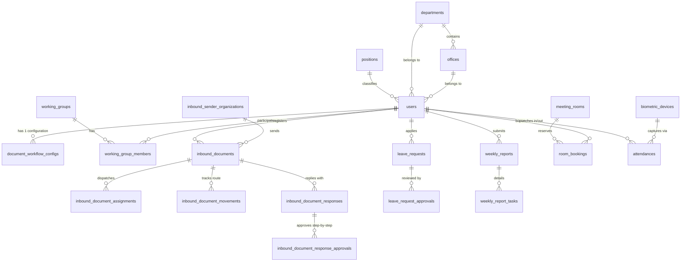

# ឯកសារស្ថាបត្យកម្ម និងរចនាសម្ព័ន្ធទិន្នន័យប្រព័ន្ធ (TRMS Database Architecture & Schema Documentation)

> **ប្រព័ន្ធ**: TRMS (Trust Regulator Management System - និយ័តករបរធនបាលកិច្ច)
> **កាលបរិច្ឆេទបច្ចុប្បន្នភាព**: 02-11-2026 09:55:49
> **ទិន្នន័យសរុប**: 44 តារាង (Tables)
> **Database Engine**: MySQL 8.0+ (InnoDB, utf8mb4_unicode_ci)

---

## ១. សេចក្តីសង្ខេប និងស្ថាបត្យកម្មទូទៅ (Executive Architecture Overview)

ប្រព័ន្ធទិន្នន័យរបស់ TRMS ត្រូវបានរៀបចំឡើងជា ៩ ម៉ូឌុលចម្បង ដោយផ្តោតលើភាពសុក្រឹតនៃទិន្នន័យរដ្ឋបាលសាធារណៈ (Relational Integrity), ល្បឿនប្រតិបត្តិការ (Indexed Keys), និងប្រព័ន្ធសុវត្ថិភាពលំហូរឯកសារ (Granular Role & Workflow Access Control)។

### ប្លង់ទំនាក់ទំនងស្ថាបត្យកម្មស្នូល (Core Entity-Relationship Diagram)

---

## ២. តារាងសង្ខេបម៉ូឌុលទាំង ៩ នៃប្រព័ន្ធ (Module Summary)

| ល.រ | ម៉ូឌុលមុខងារ (Functional Module) | ចំនួនតារាង | បញ្ជីតារាង | ការពិពណ៌នា |
| :---: | :--- | :---: | :--- | :--- |
| 1 | **Module 1: Organizational Structure & Identity (រចនាសម្ព័ន្ធស្ថាប័ន និងគណនីមន្ត្រី)** | 8 | `users`, `positions`, `additional_positions`, `departments`, `offices`, `working_groups`, `working_group_members`, `personal_access_tokens` | គ្រប់គ្រងព័ត៌មានបុគ្គលិក/មន្ត្រី ឋានានុក្រមមុខតំណែង នាយកដ្ឋាន ការិយាល័យ ក្រុមការងារ និង Token ផ្ទៀងផ្ទាត់សិទ្ធិ។ |
| 2 | **Module 2: Document Management & Workflow Engine (ប្រព័ន្ធគ្រប់គ្រងលំហូរឯកសារ និងការឆ្លង/បញ្ជូន)** | 8 | `inbound_documents`, `inbound_document_assignments`, `inbound_document_movements`, `inbound_document_responses`, `inbound_document_response_approvals`, `document_workflow_configs`, `inbound_sender_organizations`, `document_templates` | បេះដូងនៃប្រព័ន្ធ TRMS សម្រាប់គ្រប់គ្រងលិខិតចូល កំណត់ចំណារចាត់តាំង ប្រវត្តិចរន្តឯកសារ លិខិតឆ្លើយតប ការពិនិត្យអនុម័ត គំរូឯកសារ និងការកំណត់សិទ្ធិមើល/បញ្ជូនឯកសារ (Workflow Configuration)។ |
| 3 | **Module 3: Leave Request System (ប្រព័ន្ធគ្រប់គ្រងការសុំច្បាប់ឈប់សម្រាក)** | 2 | `leave_requests`, `leave_request_approvals` | គ្រប់គ្រងការស្នើសុំច្បាប់ឈប់សម្រាករបស់មន្ត្រី និងលំហូរនៃការអនុម័តតាមឋានានុក្រម។ |
| 4 | **Module 4: Weekly Reporting & Task Tracking (ប្រព័ន្ធរបាយការណ៍ការងារប្រចាំសប្តាហ៍)** | 2 | `weekly_reports`, `weekly_report_tasks` | កត់ត្រារបាយការណ៍សកម្មភាពការងារប្រចាំសប្តាហ៍របស់មន្ត្រីតាមអង្គភាព និងតាមដានវឌ្ឍនភាពការងារ។ |
| 5 | **Module 5: Meeting Room Reservations (ប្រព័ន្ធកក់បន្ទប់ប្រជុំ)** | 2 | `meeting_rooms`, `room_bookings` | គ្រប់គ្រងបន្ទប់ប្រជុំ និងកាលវិភាគស្នើសុំកក់បន្ទប់ប្រជុំរបស់អង្គភាពនានា។ |
| 6 | **Module 6: Attendance & Biometrics (ប្រព័ន្ធកត់ត្រាវត្តមាន និងឧបករណ៍ស្កេន)** | 3 | `attendances`, `biometric_devices`, `attendance_device_logs` | កត់ត្រាវត្តមានមន្ត្រីប្រចាំថ្ងៃ និងតភ្ជាប់ Sync ទិន្នន័យពីម៉ាស៊ីនស្កេនវត្តមាន Hikvision Biometrics។ |
| 7 | **Module 7: Work Schedules (កាលវិភាគការងារ)** | 1 | `work_schedules` | កំណត់វេនការងារ និងម៉ោងធ្វើការផ្លូវការរបស់មន្ត្រី។ |
| 8 | **Module 8: HR Extended Profiles & Background (ប្រវត្តិរូបសង្ខេបលម្អិតរបស់មន្ត្រី)** | 10 | `user_educations`, `user_languages`, `user_decorations`, `user_siblings`, `user_children`, `disciplinary_actions`, `out_of_framework_statuses`, `unpaid_leaves`, `public_work_histories`, `private_work_histories` | ព័ត៌មានបន្ថែមពីប្រវត្តិរូបមន្ត្រី ដូចជាការសិក្សា ភាសា គ្រឿងឥស្សរិយយស គ្រួសារ វិន័យ និងប្រវត្តិការងារកន្លងមក។ |
| 9 | **Module 9: System & Queue Infrastructure (ប្រព័ន្ធជំនួយ Cache, Queue & Migrations)** | 6 | `cache`, `cache_locks`, `jobs`, `job_batches`, `failed_jobs`, `migrations` | តារាងបច្ចេកទេសរបស់ Laravel Framework សម្រាប់ដំណើរការ Cache, Async Job Queues និង Database Versioning។ |

---

## ៣. រចនាសម្ព័ន្ធលម្អិតតាមតារាងនីមួយៗ (Detailed Schema per Table)

### 📂 Module 1: Organizational Structure & Identity (រចនាសម្ព័ន្ធស្ថាប័ន និងគណនីមន្ត្រី)
_គ្រប់គ្រងព័ត៌មានបុគ្គលិក/មន្ត្រី ឋានានុក្រមមុខតំណែង នាយកដ្ឋាន ការិយាល័យ ក្រុមការងារ និង Token ផ្ទៀងផ្ទាត់សិទ្ធិ។_

#### 1. តារាង `users`
- **ចំនួនទិន្នន័យបច្ចុប្បន្ន (Records)**: `79` ជួរ
- **Foreign Key Relations**: `department_id` ➔ `departments.id`, `office_id` ➔ `offices.id`, `position_id` ➔ `positions.id`

| Field | Type | Nullable | Key | Default | Extra | ការពិពណ៌នា / សម្គាល់ |
| :--- | :--- | :---: | :---: | :--- | :--- | :--- |
| `id` | `bigint unsigned` | No | 🔑 **PK** | _None_ | auto_increment | លេខសម្គាល់ចម្បង (Primary Key Auto-Increment) |
| `name` | `varchar(255)` | No | - | _None_ | - | ឈ្មោះជាភាសាខ្មែរ |
| `email` | `varchar(255)` | Yes | ✨ **UK** | _NULL_ | - | - |
| `telegram_chat_id` | `varchar(100)` | Yes | - | _NULL_ | - | - |
| `telegram_username` | `varchar(100)` | Yes | - | _NULL_ | - | - |
| `email_verified_at` | `timestamp` | Yes | - | _NULL_ | - | - |
| `password` | `varchar(255)` | Yes | - | _NULL_ | - | - |
| `department_id` | `bigint unsigned` | Yes | 🔗 **FK/IDX** | _NULL_ | - | ភ្ជាប់ទៅតារាង departments (ID នាយកដ្ឋាន) |
| `office_id` | `bigint unsigned` | Yes | 🔗 **FK/IDX** | _NULL_ | - | ភ្ជាប់ទៅតារាង offices (ID ការិយាល័យ) |
| `position_id` | `bigint unsigned` | Yes | 🔗 **FK/IDX** | _NULL_ | - | ភ្ជាប់ទៅតារាង positions (ID តួនាទី/មុខតំណែង) |
| `employee_code` | `varchar(255)` | Yes | - | _NULL_ | - | - |
| `mef_card_number` | `varchar(255)` | Yes | - | _NULL_ | - | - |
| `employee_type` | `enum('CIVIL_SERVICE','STATUTORY','CONTRACT','OTHER')` | No | - | `CIVIL_SERVICE` | - | - |
| `officer_status` | `varchar(255)` | No | - | `ACTIVE` | - | - |
| `officer_status_date` | `date` | Yes | - | _NULL_ | - | - |
| `officer_status_reason` | `varchar(500)` | Yes | - | _NULL_ | - | - |
| `name_kh` | `varchar(255)` | No | - | _None_ | - | ឈ្មោះជាភាសាខ្មែរ |
| `name_en` | `varchar(255)` | Yes | - | _NULL_ | - | ឈ្មោះជាភាសាអង់គ្លេស / ឡាតាំង |
| `gender` | `enum('Male','Female')` | No | - | _None_ | - | - |
| `marital_status` | `enum('Single','Married','Divorced','Widowed')` | Yes | - | _NULL_ | - | - |
| `dob` | `date` | Yes | - | _NULL_ | - | - |
| `birth_place` | `text` | Yes | - | _NULL_ | - | - |
| `current_address` | `text` | Yes | - | _NULL_ | - | - |
| `phone` | `varchar(255)` | Yes | - | _NULL_ | - | - |
| `profile_image` | `varchar(255)` | Yes | - | _NULL_ | - | - |
| `national_id_number` | `varchar(255)` | Yes | - | _NULL_ | - | - |
| `national_id_expired_date` | `date` | Yes | - | _NULL_ | - | - |
| `national_id_file` | `varchar(255)` | Yes | - | _NULL_ | - | - |
| `passport_number` | `varchar(255)` | Yes | - | _NULL_ | - | - |
| `passport_expired_date` | `date` | Yes | - | _NULL_ | - | - |
| `passport_file` | `varchar(255)` | Yes | - | _NULL_ | - | - |
| `level` | `varchar(255)` | No | - | `USER` | - | - |
| `permissions` | `json` | Yes | - | _NULL_ | - | - |
| `status` | `enum('ACTIVE','DISABLED','RETIRED','RESIGNED','ENABLED')` | No | - | `ACTIVE` | - | ស្ថានភាព (Active, Inactive, Pending, Approved, etc.) |
| `remember_token` | `varchar(100)` | Yes | - | _NULL_ | - | - |
| `created_at` | `timestamp` | Yes | - | _NULL_ | - | កាលបរិច្ឆេទ និងម៉ោងបង្កើត Record |
| `updated_at` | `timestamp` | Yes | - | _NULL_ | - | កាលបរិច្ឆេទ និងម៉ោងកែប្រែចុងក្រោយ |
| `deleted_at` | `timestamp` | Yes | - | _NULL_ | - | កាលបរិច្ឆេទលុប (Soft Delete) |
| `first_service_date` | `date` | Yes | - | _NULL_ | - | - |
| `first_appointment_date` | `date` | Yes | - | _NULL_ | - | - |
| `initial_framework` | `varchar(255)` | Yes | - | _NULL_ | - | - |
| `initial_position` | `varchar(255)` | Yes | - | _NULL_ | - | - |
| `initial_ministry` | `varchar(255)` | Yes | - | _NULL_ | - | - |
| `initial_unit` | `varchar(255)` | Yes | - | _NULL_ | - | - |
| `initial_department` | `varchar(255)` | Yes | - | _NULL_ | - | - |
| `initial_office` | `varchar(255)` | Yes | - | _NULL_ | - | - |
| `current_framework` | `varchar(255)` | Yes | - | _NULL_ | - | - |
| `current_appointment_date` | `date` | Yes | - | _NULL_ | - | - |
| `current_position_date` | `varchar(255)` | Yes | - | _NULL_ | - | - |
| `father_name` | `varchar(255)` | Yes | - | _NULL_ | - | - |
| `father_latin_name` | `varchar(255)` | Yes | - | _NULL_ | - | - |
| `father_status` | `varchar(255)` | Yes | - | _NULL_ | - | - |
| `father_dob` | `date` | Yes | - | _NULL_ | - | - |
| `father_nationality` | `varchar(255)` | Yes | - | _NULL_ | - | - |
| `father_address` | `varchar(255)` | Yes | - | _NULL_ | - | - |
| `father_occupation` | `varchar(255)` | Yes | - | _NULL_ | - | - |
| `father_unit` | `varchar(255)` | Yes | - | _NULL_ | - | - |
| `mother_name` | `varchar(255)` | Yes | - | _NULL_ | - | - |
| `mother_latin_name` | `varchar(255)` | Yes | - | _NULL_ | - | - |
| `mother_status` | `varchar(255)` | Yes | - | _NULL_ | - | - |
| `mother_dob` | `date` | Yes | - | _NULL_ | - | - |
| `mother_nationality` | `varchar(255)` | Yes | - | _NULL_ | - | - |
| `mother_address` | `varchar(255)` | Yes | - | _NULL_ | - | - |
| `mother_occupation` | `varchar(255)` | Yes | - | _NULL_ | - | - |
| `mother_unit` | `varchar(255)` | Yes | - | _NULL_ | - | - |
| `spouse_name` | `varchar(255)` | Yes | - | _NULL_ | - | - |
| `spouse_latin_name` | `varchar(255)` | Yes | - | _NULL_ | - | - |
| `spouse_status` | `varchar(255)` | Yes | - | _NULL_ | - | - |
| `spouse_dob` | `date` | Yes | - | _NULL_ | - | - |
| `spouse_nationality` | `varchar(255)` | Yes | - | _NULL_ | - | - |
| `spouse_birthplace` | `varchar(255)` | Yes | - | _NULL_ | - | - |
| `spouse_occupation` | `varchar(255)` | Yes | - | _NULL_ | - | - |
| `spouse_unit` | `varchar(255)` | Yes | - | _NULL_ | - | - |
| `spouse_allowance` | `varchar(255)` | Yes | - | _NULL_ | - | - |
| `spouse_phone` | `varchar(255)` | Yes | - | _NULL_ | - | - |

> **Indexes បន្ថែម**: `users_email_unique` (email); `users_department_id_foreign` (department_id); `users_office_id_foreign` (office_id); `users_position_id_foreign` (position_id)

#### 2. តារាង `positions`
- **ចំនួនទិន្នន័យបច្ចុប្បន្ន (Records)**: `11` ជួរ

| Field | Type | Nullable | Key | Default | Extra | ការពិពណ៌នា / សម្គាល់ |
| :--- | :--- | :---: | :---: | :--- | :--- | :--- |
| `id` | `bigint unsigned` | No | 🔑 **PK** | _None_ | auto_increment | លេខសម្គាល់ចម្បង (Primary Key Auto-Increment) |
| `title_kh` | `varchar(255)` | No | - | _None_ | - | ចំណងជើងជាភាសាខ្មែរ |
| `title_en` | `varchar(255)` | Yes | - | _NULL_ | - | ចំណងជើងជាភាសាអង់គ្លេស |
| `level` | `int` | No | - | `1` | - | - |
| `created_at` | `timestamp` | Yes | - | _NULL_ | - | កាលបរិច្ឆេទ និងម៉ោងបង្កើត Record |
| `updated_at` | `timestamp` | Yes | - | _NULL_ | - | កាលបរិច្ឆេទ និងម៉ោងកែប្រែចុងក្រោយ |

#### 3. តារាង `additional_positions`
- **ចំនួនទិន្នន័យបច្ចុប្បន្ន (Records)**: `0` ជួរ
- **Foreign Key Relations**: `user_id` ➔ `users.id`

| Field | Type | Nullable | Key | Default | Extra | ការពិពណ៌នា / សម្គាល់ |
| :--- | :--- | :---: | :---: | :--- | :--- | :--- |
| `id` | `bigint unsigned` | No | 🔑 **PK** | _None_ | auto_increment | លេខសម្គាល់ចម្បង (Primary Key Auto-Increment) |
| `user_id` | `bigint unsigned` | No | 🔗 **FK/IDX** | _None_ | - | ភ្ជាប់ទៅតារាង users (ID របស់មន្ត្រី) |
| `date` | `date` | Yes | - | _NULL_ | - | - |
| `document` | `varchar(255)` | Yes | - | _NULL_ | - | - |
| `position` | `varchar(255)` | Yes | - | _NULL_ | - | - |
| `equivalent_status` | `varchar(255)` | Yes | - | _NULL_ | - | - |
| `unit` | `varchar(255)` | Yes | - | _NULL_ | - | - |
| `created_at` | `timestamp` | Yes | - | _NULL_ | - | កាលបរិច្ឆេទ និងម៉ោងបង្កើត Record |
| `updated_at` | `timestamp` | Yes | - | _NULL_ | - | កាលបរិច្ឆេទ និងម៉ោងកែប្រែចុងក្រោយ |

> **Indexes បន្ថែម**: `additional_positions_user_id_foreign` (user_id)

#### 4. តារាង `departments`
- **ចំនួនទិន្នន័យបច្ចុប្បន្ន (Records)**: `4` ជួរ

| Field | Type | Nullable | Key | Default | Extra | ការពិពណ៌នា / សម្គាល់ |
| :--- | :--- | :---: | :---: | :--- | :--- | :--- |
| `id` | `bigint unsigned` | No | 🔑 **PK** | _None_ | auto_increment | លេខសម្គាល់ចម្បង (Primary Key Auto-Increment) |
| `code` | `varchar(255)` | No | ✨ **UK** | _None_ | - | កូដកត់ត្រាសម្គាល់ (Code / Short Code) |
| `name_kh` | `varchar(255)` | No | - | _None_ | - | ឈ្មោះជាភាសាខ្មែរ |
| `name_en` | `varchar(255)` | Yes | - | _NULL_ | - | ឈ្មោះជាភាសាអង់គ្លេស / ឡាតាំង |
| `created_at` | `timestamp` | Yes | - | _NULL_ | - | កាលបរិច្ឆេទ និងម៉ោងបង្កើត Record |
| `updated_at` | `timestamp` | Yes | - | _NULL_ | - | កាលបរិច្ឆេទ និងម៉ោងកែប្រែចុងក្រោយ |

> **Indexes បន្ថែម**: `departments_code_unique` (code)

#### 5. តារាង `offices`
- **ចំនួនទិន្នន័យបច្ចុប្បន្ន (Records)**: `12` ជួរ
- **Foreign Key Relations**: `department_id` ➔ `departments.id`

| Field | Type | Nullable | Key | Default | Extra | ការពិពណ៌នា / សម្គាល់ |
| :--- | :--- | :---: | :---: | :--- | :--- | :--- |
| `id` | `bigint unsigned` | No | 🔑 **PK** | _None_ | auto_increment | លេខសម្គាល់ចម្បង (Primary Key Auto-Increment) |
| `department_id` | `bigint unsigned` | No | 🔗 **FK/IDX** | _None_ | - | ភ្ជាប់ទៅតារាង departments (ID នាយកដ្ឋាន) |
| `code` | `varchar(255)` | No | ✨ **UK** | _None_ | - | កូដកត់ត្រាសម្គាល់ (Code / Short Code) |
| `name_kh` | `varchar(255)` | No | - | _None_ | - | ឈ្មោះជាភាសាខ្មែរ |
| `name_en` | `varchar(255)` | Yes | - | _NULL_ | - | ឈ្មោះជាភាសាអង់គ្លេស / ឡាតាំង |
| `created_at` | `timestamp` | Yes | - | _NULL_ | - | កាលបរិច្ឆេទ និងម៉ោងបង្កើត Record |
| `updated_at` | `timestamp` | Yes | - | _NULL_ | - | កាលបរិច្ឆេទ និងម៉ោងកែប្រែចុងក្រោយ |

> **Indexes បន្ថែម**: `offices_code_unique` (code); `offices_department_id_foreign` (department_id)

#### 6. តារាង `working_groups`
- **ចំនួនទិន្នន័យបច្ចុប្បន្ន (Records)**: `2` ជួរ
- **Foreign Key Relations**: `created_by` ➔ `users.id`

| Field | Type | Nullable | Key | Default | Extra | ការពិពណ៌នា / សម្គាល់ |
| :--- | :--- | :---: | :---: | :--- | :--- | :--- |
| `id` | `bigint unsigned` | No | 🔑 **PK** | _None_ | auto_increment | លេខសម្គាល់ចម្បង (Primary Key Auto-Increment) |
| `name_kh` | `varchar(255)` | No | - | _None_ | - | ឈ្មោះជាភាសាខ្មែរ |
| `name_en` | `varchar(255)` | Yes | - | _NULL_ | - | ឈ្មោះជាភាសាអង់គ្លេស / ឡាតាំង |
| `code` | `varchar(50)` | Yes | - | _NULL_ | - | កូដកត់ត្រាសម្គាល់ (Code / Short Code) |
| `reference_document` | `varchar(255)` | Yes | - | _NULL_ | - | - |
| `established_date` | `date` | Yes | - | _NULL_ | - | - |
| `description` | `text` | Yes | - | _NULL_ | - | កំណត់ចំណាំ ឬការពិពណ៌នាលម្អិត |
| `status` | `varchar(50)` | No | - | `ACTIVE` | - | ស្ថានភាព (Active, Inactive, Pending, Approved, etc.) |
| `order_index` | `int` | No | - | `0` | - | - |
| `created_by` | `bigint unsigned` | Yes | 🔗 **FK/IDX** | _NULL_ | - | ID របស់មន្ត្រីដែលបានបង្កើត Record នេះ |
| `created_at` | `timestamp` | Yes | - | _NULL_ | - | កាលបរិច្ឆេទ និងម៉ោងបង្កើត Record |
| `updated_at` | `timestamp` | Yes | - | _NULL_ | - | កាលបរិច្ឆេទ និងម៉ោងកែប្រែចុងក្រោយ |
| `deleted_at` | `timestamp` | Yes | - | _NULL_ | - | កាលបរិច្ឆេទលុប (Soft Delete) |

> **Indexes បន្ថែម**: `working_groups_created_by_foreign` (created_by)

#### 7. តារាង `working_group_members`
- **ចំនួនទិន្នន័យបច្ចុប្បន្ន (Records)**: `19` ជួរ
- **Foreign Key Relations**: `user_id` ➔ `users.id`, `working_group_id` ➔ `working_groups.id`

| Field | Type | Nullable | Key | Default | Extra | ការពិពណ៌នា / សម្គាល់ |
| :--- | :--- | :---: | :---: | :--- | :--- | :--- |
| `id` | `bigint unsigned` | No | 🔑 **PK** | _None_ | auto_increment | លេខសម្គាល់ចម្បង (Primary Key Auto-Increment) |
| `working_group_id` | `bigint unsigned` | No | 🔗 **FK/IDX** | _None_ | - | ភ្ជាប់ទៅតារាង working_groups (ID ក្រុមការងារ) |
| `user_id` | `bigint unsigned` | No | 🔗 **FK/IDX** | _None_ | - | ភ្ជាប់ទៅតារាង users (ID របស់មន្ត្រី) |
| `role` | `varchar(50)` | No | - | `MEMBER` | - | - |
| `custom_role_kh` | `varchar(150)` | Yes | - | _NULL_ | - | - |
| `joined_date` | `date` | Yes | - | _NULL_ | - | - |
| `status` | `varchar(50)` | No | - | `ACTIVE` | - | ស្ថានភាព (Active, Inactive, Pending, Approved, etc.) |
| `order_index` | `int` | No | - | `0` | - | - |
| `notes` | `text` | Yes | - | _NULL_ | - | កំណត់ចំណាំ ឬការពិពណ៌នាលម្អិត |
| `created_at` | `timestamp` | Yes | - | _NULL_ | - | កាលបរិច្ឆេទ និងម៉ោងបង្កើត Record |
| `updated_at` | `timestamp` | Yes | - | _NULL_ | - | កាលបរិច្ឆេទ និងម៉ោងកែប្រែចុងក្រោយ |
| `deleted_at` | `timestamp` | Yes | - | _NULL_ | - | កាលបរិច្ឆេទលុប (Soft Delete) |

> **Indexes បន្ថែម**: `working_group_members_working_group_id_user_id_index` (working_group_id, user_id); `working_group_members_user_id_role_index` (user_id, role)

#### 8. តារាង `personal_access_tokens`
- **ចំនួនទិន្នន័យបច្ចុប្បន្ន (Records)**: `19` ជួរ

| Field | Type | Nullable | Key | Default | Extra | ការពិពណ៌នា / សម្គាល់ |
| :--- | :--- | :---: | :---: | :--- | :--- | :--- |
| `id` | `bigint unsigned` | No | 🔑 **PK** | _None_ | auto_increment | លេខសម្គាល់ចម្បង (Primary Key Auto-Increment) |
| `tokenable_type` | `varchar(255)` | No | 🔗 **FK/IDX** | _None_ | - | - |
| `tokenable_id` | `bigint unsigned` | No | - | _None_ | - | - |
| `name` | `text` | No | - | _None_ | - | ឈ្មោះជាភាសាខ្មែរ |
| `token` | `varchar(64)` | No | ✨ **UK** | _None_ | - | - |
| `abilities` | `text` | Yes | - | _NULL_ | - | - |
| `last_used_at` | `timestamp` | Yes | - | _NULL_ | - | - |
| `expires_at` | `timestamp` | Yes | 🔗 **FK/IDX** | _NULL_ | - | - |
| `created_at` | `timestamp` | Yes | - | _NULL_ | - | កាលបរិច្ឆេទ និងម៉ោងបង្កើត Record |
| `updated_at` | `timestamp` | Yes | - | _NULL_ | - | កាលបរិច្ឆេទ និងម៉ោងកែប្រែចុងក្រោយ |

> **Indexes បន្ថែម**: `personal_access_tokens_token_unique` (token); `personal_access_tokens_tokenable_type_tokenable_id_index` (tokenable_type, tokenable_id); `personal_access_tokens_expires_at_index` (expires_at)

### 📂 Module 2: Document Management & Workflow Engine (ប្រព័ន្ធគ្រប់គ្រងលំហូរឯកសារ និងការឆ្លង/បញ្ជូន)
_បេះដូងនៃប្រព័ន្ធ TRMS សម្រាប់គ្រប់គ្រងលិខិតចូល កំណត់ចំណារចាត់តាំង ប្រវត្តិចរន្តឯកសារ លិខិតឆ្លើយតប ការពិនិត្យអនុម័ត គំរូឯកសារ និងការកំណត់សិទ្ធិមើល/បញ្ជូនឯកសារ (Workflow Configuration)។_

#### 9. តារាង `inbound_documents`
- **ចំនួនទិន្នន័យបច្ចុប្បន្ន (Records)**: `5` ជួរ
- **Foreign Key Relations**: `acknowledged_by` ➔ `users.id`, `dg_assistant_id` ➔ `users.id`, `dispatched_by` ➔ `users.id`, `registered_by` ➔ `users.id`, `target_department_id` ➔ `departments.id`, `target_office_id` ➔ `offices.id`, `target_user_id` ➔ `users.id`

| Field | Type | Nullable | Key | Default | Extra | ការពិពណ៌នា / សម្គាល់ |
| :--- | :--- | :---: | :---: | :--- | :--- | :--- |
| `id` | `bigint unsigned` | No | 🔑 **PK** | _None_ | auto_increment | លេខសម្គាល់ចម្បង (Primary Key Auto-Increment) |
| `general_inbound_number` | `varchar(50)` | Yes | 🔗 **FK/IDX** | _NULL_ | - | - |
| `general_inbound_seq` | `int unsigned` | Yes | - | _NULL_ | - | - |
| `general_inbound_year` | `varchar(4)` | Yes | - | _NULL_ | - | - |
| `received_date` | `date` | No | - | _None_ | - | កាលបរិច្ឆេទដែលប្រព័ន្ធបានទទួល |
| `received_time` | `time` | No | - | _None_ | - | - |
| `deliverer_name` | `varchar(255)` | No | - | _None_ | - | - |
| `deliverer_phone` | `varchar(50)` | Yes | - | _NULL_ | - | - |
| `sender_organization` | `varchar(255)` | No | - | _None_ | - | - |
| `external_reference_number` | `varchar(100)` | Yes | - | _NULL_ | - | - |
| `external_document_date` | `date` | Yes | - | _NULL_ | - | - |
| `title` | `text` | No | - | _None_ | - | ចំណងជើងជាភាសាខ្មែរ |
| `document_type` | `varchar(50)` | No | - | `LETTER` | - | - |
| `urgency` | `varchar(50)` | No | - | `NORMAL` | - | - |
| `confidentiality` | `varchar(50)` | No | - | `NORMAL` | - | - |
| `receptionist_notes` | `text` | Yes | - | _NULL_ | - | - |
| `original_file_path` | `varchar(255)` | Yes | - | _NULL_ | - | - |
| `original_file_name` | `varchar(255)` | Yes | - | _NULL_ | - | - |
| `registered_by` | `bigint unsigned` | No | 🔗 **FK/IDX** | _None_ | - | - |
| `dg_inbound_category` | `varchar(50)` | Yes | - | _NULL_ | - | - |
| `dg_inbound_prefix` | `varchar(10)` | Yes | - | _NULL_ | - | - |
| `dg_inbound_seq` | `int unsigned` | Yes | - | _NULL_ | - | - |
| `dg_inbound_year` | `varchar(4)` | Yes | - | _NULL_ | - | - |
| `dg_inbound_number` | `varchar(50)` | Yes | 🔗 **FK/IDX** | _NULL_ | - | - |
| `dg_received_date` | `date` | Yes | - | _NULL_ | - | - |
| `dg_assistant_id` | `bigint unsigned` | Yes | 🔗 **FK/IDX** | _NULL_ | - | - |
| `dg_assistant_notes` | `text` | Yes | - | _NULL_ | - | - |
| `dg_annotation` | `text` | Yes | - | _NULL_ | - | - |
| `dg_annotated_at` | `timestamp` | Yes | - | _NULL_ | - | - |
| `is_response_required` | `tinyint(1)` | No | - | `0` | - | - |
| `deadline` | `date` | Yes | 🔗 **FK/IDX** | _NULL_ | - | កាលបរិច្ឆេទកំណត់បញ្ចប់ការងារ (Deadline) |
| `annotated_file_path` | `varchar(255)` | Yes | - | _NULL_ | - | - |
| `annotated_file_name` | `varchar(255)` | Yes | - | _NULL_ | - | - |
| `dispatched_at` | `timestamp` | Yes | - | _NULL_ | - | - |
| `dispatched_by` | `bigint unsigned` | Yes | 🔗 **FK/IDX** | _NULL_ | - | - |
| `target_type` | `varchar(50)` | Yes | - | _NULL_ | - | - |
| `target_department_id` | `bigint unsigned` | Yes | 🔗 **FK/IDX** | _NULL_ | - | - |
| `target_office_id` | `bigint unsigned` | Yes | 🔗 **FK/IDX** | _NULL_ | - | - |
| `target_user_id` | `bigint unsigned` | Yes | 🔗 **FK/IDX** | _NULL_ | - | - |
| `dispatch_notes` | `text` | Yes | - | _NULL_ | - | - |
| `status` | `varchar(50)` | No | 🔗 **FK/IDX** | `RECEPTION_DRAFT` | - | ស្ថានភាព (Active, Inactive, Pending, Approved, etc.) |
| `acknowledged_at` | `timestamp` | Yes | - | _NULL_ | - | - |
| `acknowledged_by` | `bigint unsigned` | Yes | 🔗 **FK/IDX** | _NULL_ | - | - |
| `completed_at` | `timestamp` | Yes | - | _NULL_ | - | - |
| `created_at` | `timestamp` | Yes | - | _NULL_ | - | កាលបរិច្ឆេទ និងម៉ោងបង្កើត Record |
| `updated_at` | `timestamp` | Yes | - | _NULL_ | - | កាលបរិច្ឆេទ និងម៉ោងកែប្រែចុងក្រោយ |
| `deleted_at` | `timestamp` | Yes | - | _NULL_ | - | កាលបរិច្ឆេទលុប (Soft Delete) |

> **Indexes បន្ថែម**: `inbound_documents_registered_by_foreign` (registered_by); `inbound_documents_dg_assistant_id_foreign` (dg_assistant_id); `inbound_documents_dispatched_by_foreign` (dispatched_by); `inbound_documents_target_department_id_foreign` (target_department_id); `inbound_documents_target_office_id_foreign` (target_office_id); `inbound_documents_target_user_id_foreign` (target_user_id); `inbound_documents_acknowledged_by_foreign` (acknowledged_by); `inbound_documents_general_inbound_number_index` (general_inbound_number); `inbound_documents_dg_inbound_number_index` (dg_inbound_number); `inbound_documents_status_index` (status); `inbound_documents_deadline_index` (deadline)

#### 10. តារាង `inbound_document_assignments`
- **ចំនួនទិន្នន័យបច្ចុប្បន្ន (Records)**: `9` ជួរ
- **Foreign Key Relations**: `assigned_by` ➔ `users.id`, `department_id` ➔ `departments.id`, `inbound_document_id` ➔ `inbound_documents.id`, `office_id` ➔ `offices.id`, `parent_assignment_id` ➔ `inbound_document_assignments.id`, `user_id` ➔ `users.id`, `working_group_id` ➔ `working_groups.id`

| Field | Type | Nullable | Key | Default | Extra | ការពិពណ៌នា / សម្គាល់ |
| :--- | :--- | :---: | :---: | :--- | :--- | :--- |
| `id` | `bigint unsigned` | No | 🔑 **PK** | _None_ | auto_increment | លេខសម្គាល់ចម្បង (Primary Key Auto-Increment) |
| `inbound_document_id` | `bigint unsigned` | No | 🔗 **FK/IDX** | _None_ | - | - |
| `assigned_by` | `bigint unsigned` | No | 🔗 **FK/IDX** | _None_ | - | ID របស់ថ្នាក់ដឹកនាំដែលបានចាត់តាំង |
| `parent_assignment_id` | `bigint unsigned` | Yes | 🔗 **FK/IDX** | _NULL_ | - | - |
| `target_type` | `varchar(50)` | No | - | _None_ | - | - |
| `department_id` | `bigint unsigned` | Yes | 🔗 **FK/IDX** | _NULL_ | - | ភ្ជាប់ទៅតារាង departments (ID នាយកដ្ឋាន) |
| `office_id` | `bigint unsigned` | Yes | 🔗 **FK/IDX** | _NULL_ | - | ភ្ជាប់ទៅតារាង offices (ID ការិយាល័យ) |
| `user_id` | `bigint unsigned` | Yes | 🔗 **FK/IDX** | _NULL_ | - | ភ្ជាប់ទៅតារាង users (ID របស់មន្ត្រី) |
| `working_group_id` | `bigint unsigned` | Yes | 🔗 **FK/IDX** | _NULL_ | - | ភ្ជាប់ទៅតារាង working_groups (ID ក្រុមការងារ) |
| `instruction` | `text` | Yes | - | _NULL_ | - | ការណែនាំ ឬចំណាររបស់ថ្នាក់ដឹកនាំ |
| `status` | `varchar(50)` | No | - | `PENDING` | - | ស្ថានភាព (Active, Inactive, Pending, Approved, etc.) |
| `acknowledged_at` | `timestamp` | Yes | - | _NULL_ | - | - |
| `completed_at` | `timestamp` | Yes | - | _NULL_ | - | - |
| `created_at` | `timestamp` | Yes | - | _NULL_ | - | កាលបរិច្ឆេទ និងម៉ោងបង្កើត Record |
| `updated_at` | `timestamp` | Yes | - | _NULL_ | - | កាលបរិច្ឆេទ និងម៉ោងកែប្រែចុងក្រោយ |
| `deleted_at` | `timestamp` | Yes | - | _NULL_ | - | កាលបរិច្ឆេទលុប (Soft Delete) |

> **Indexes បន្ថែម**: `inbound_document_assignments_inbound_document_id_foreign` (inbound_document_id); `inbound_document_assignments_assigned_by_foreign` (assigned_by); `inbound_document_assignments_parent_assignment_id_foreign` (parent_assignment_id); `inbound_document_assignments_department_id_foreign` (department_id); `inbound_document_assignments_office_id_foreign` (office_id); `inbound_document_assignments_user_id_foreign` (user_id); `inbound_document_assignments_working_group_id_foreign` (working_group_id)

#### 11. តារាង `inbound_document_movements`
- **ចំនួនទិន្នន័យបច្ចុប្បន្ន (Records)**: `6` ជួរ
- **Foreign Key Relations**: `inbound_document_id` ➔ `inbound_documents.id`, `user_id` ➔ `users.id`

| Field | Type | Nullable | Key | Default | Extra | ការពិពណ៌នា / សម្គាល់ |
| :--- | :--- | :---: | :---: | :--- | :--- | :--- |
| `id` | `bigint unsigned` | No | 🔑 **PK** | _None_ | auto_increment | លេខសម្គាល់ចម្បង (Primary Key Auto-Increment) |
| `inbound_document_id` | `bigint unsigned` | No | 🔗 **FK/IDX** | _None_ | - | - |
| `user_id` | `bigint unsigned` | No | 🔗 **FK/IDX** | _None_ | - | ភ្ជាប់ទៅតារាង users (ID របស់មន្ត្រី) |
| `action` | `varchar(50)` | No | - | _None_ | - | - |
| `from_status` | `varchar(50)` | Yes | - | _NULL_ | - | - |
| `to_status` | `varchar(50)` | Yes | - | _NULL_ | - | - |
| `comment` | `text` | Yes | - | _NULL_ | - | - |
| `meta` | `json` | Yes | - | _NULL_ | - | - |
| `created_at` | `timestamp` | Yes | - | _NULL_ | - | កាលបរិច្ឆេទ និងម៉ោងបង្កើត Record |
| `updated_at` | `timestamp` | Yes | - | _NULL_ | - | កាលបរិច្ឆេទ និងម៉ោងកែប្រែចុងក្រោយ |

> **Indexes បន្ថែម**: `inbound_document_movements_inbound_document_id_foreign` (inbound_document_id); `inbound_document_movements_user_id_foreign` (user_id)

#### 12. តារាង `inbound_document_responses`
- **ចំនួនទិន្នន័យបច្ចុប្បន្ន (Records)**: `2` ជួរ
- **Foreign Key Relations**: `approved_by` ➔ `users.id`, `current_approver_id` ➔ `users.id`, `department_id` ➔ `departments.id`, `drafted_by` ➔ `users.id`, `inbound_document_id` ➔ `inbound_documents.id`, `office_id` ➔ `offices.id`

| Field | Type | Nullable | Key | Default | Extra | ការពិពណ៌នា / សម្គាល់ |
| :--- | :--- | :---: | :---: | :--- | :--- | :--- |
| `id` | `bigint unsigned` | No | 🔑 **PK** | _None_ | auto_increment | លេខសម្គាល់ចម្បង (Primary Key Auto-Increment) |
| `inbound_document_id` | `bigint unsigned` | No | 🔗 **FK/IDX** | _None_ | - | - |
| `response_type` | `varchar(50)` | No | - | `REPORT` | - | - |
| `response_number` | `varchar(50)` | Yes | - | _NULL_ | - | - |
| `title` | `text` | No | - | _None_ | - | ចំណងជើងជាភាសាខ្មែរ |
| `header_organization` | `varchar(255)` | Yes | - | _NULL_ | - | - |
| `reference_note` | `text` | Yes | - | _NULL_ | - | - |
| `content` | `longtext` | Yes | - | _NULL_ | - | - |
| `sign_title` | `varchar(150)` | Yes | - | _NULL_ | - | - |
| `sign_name` | `varchar(150)` | Yes | - | _NULL_ | - | - |
| `drafted_by` | `bigint unsigned` | No | 🔗 **FK/IDX** | _None_ | - | - |
| `department_id` | `bigint unsigned` | Yes | 🔗 **FK/IDX** | _NULL_ | - | ភ្ជាប់ទៅតារាង departments (ID នាយកដ្ឋាន) |
| `office_id` | `bigint unsigned` | Yes | 🔗 **FK/IDX** | _NULL_ | - | ភ្ជាប់ទៅតារាង offices (ID ការិយាល័យ) |
| `file_path` | `varchar(255)` | Yes | - | _NULL_ | - | ទីតាំងផ្ទុកឯកសារ (MinIO S3 / Storage Path) |
| `file_name` | `varchar(255)` | Yes | - | _NULL_ | - | ឈ្មោះឯកសារដើម |
| `current_approver_id` | `bigint unsigned` | Yes | 🔗 **FK/IDX** | _NULL_ | - | - |
| `current_stage` | `varchar(50)` | No | - | `OFFICE` | - | - |
| `status` | `varchar(50)` | No | - | `DRAFT` | - | ស្ថានភាព (Active, Inactive, Pending, Approved, etc.) |
| `submitted_at` | `timestamp` | Yes | - | _NULL_ | - | - |
| `approved_at` | `timestamp` | Yes | - | _NULL_ | - | - |
| `approved_by` | `bigint unsigned` | Yes | 🔗 **FK/IDX** | _NULL_ | - | ID មន្ត្រីអ្នកអនុម័តចុងក្រោយ |
| `created_at` | `timestamp` | Yes | - | _NULL_ | - | កាលបរិច្ឆេទ និងម៉ោងបង្កើត Record |
| `updated_at` | `timestamp` | Yes | - | _NULL_ | - | កាលបរិច្ឆេទ និងម៉ោងកែប្រែចុងក្រោយ |
| `deleted_at` | `timestamp` | Yes | - | _NULL_ | - | កាលបរិច្ឆេទលុប (Soft Delete) |

> **Indexes បន្ថែម**: `inbound_document_responses_inbound_document_id_foreign` (inbound_document_id); `inbound_document_responses_drafted_by_foreign` (drafted_by); `inbound_document_responses_department_id_foreign` (department_id); `inbound_document_responses_office_id_foreign` (office_id); `inbound_document_responses_current_approver_id_foreign` (current_approver_id); `inbound_document_responses_approved_by_foreign` (approved_by)

#### 13. តារាង `inbound_document_response_approvals`
- **ចំនួនទិន្នន័យបច្ចុប្បន្ន (Records)**: `0` ជួរ
- **Foreign Key Relations**: `forwarded_to_id` ➔ `users.id`, `response_id` ➔ `inbound_document_responses.id`, `user_id` ➔ `users.id`

| Field | Type | Nullable | Key | Default | Extra | ការពិពណ៌នា / សម្គាល់ |
| :--- | :--- | :---: | :---: | :--- | :--- | :--- |
| `id` | `bigint unsigned` | No | 🔑 **PK** | _None_ | auto_increment | លេខសម្គាល់ចម្បង (Primary Key Auto-Increment) |
| `response_id` | `bigint unsigned` | No | 🔗 **FK/IDX** | _None_ | - | - |
| `user_id` | `bigint unsigned` | No | 🔗 **FK/IDX** | _None_ | - | ភ្ជាប់ទៅតារាង users (ID របស់មន្ត្រី) |
| `action` | `varchar(50)` | No | - | _None_ | - | - |
| `stage` | `varchar(50)` | No | - | _None_ | - | - |
| `comment` | `text` | Yes | - | _NULL_ | - | - |
| `attachment_path` | `varchar(255)` | Yes | - | _NULL_ | - | - |
| `attachment_name` | `varchar(255)` | Yes | - | _NULL_ | - | - |
| `forwarded_to_id` | `bigint unsigned` | Yes | 🔗 **FK/IDX** | _NULL_ | - | - |
| `created_at` | `timestamp` | Yes | - | _NULL_ | - | កាលបរិច្ឆេទ និងម៉ោងបង្កើត Record |
| `updated_at` | `timestamp` | Yes | - | _NULL_ | - | កាលបរិច្ឆេទ និងម៉ោងកែប្រែចុងក្រោយ |

> **Indexes បន្ថែម**: `inbound_document_response_approvals_response_id_foreign` (response_id); `inbound_document_response_approvals_user_id_foreign` (user_id); `inbound_document_response_approvals_forwarded_to_id_foreign` (forwarded_to_id)

#### 14. តារាង `document_workflow_configs`
- **ចំនួនទិន្នន័យបច្ចុប្បន្ន (Records)**: `1` ជួរ
- **Foreign Key Relations**: `user_id` ➔ `users.id`

| Field | Type | Nullable | Key | Default | Extra | ការពិពណ៌នា / សម្គាល់ |
| :--- | :--- | :---: | :---: | :--- | :--- | :--- |
| `id` | `bigint unsigned` | No | 🔑 **PK** | _None_ | auto_increment | លេខសម្គាល់ចម្បង (Primary Key Auto-Increment) |
| `user_id` | `bigint unsigned` | No | ✨ **UK** | _None_ | - | ភ្ជាប់ទៅតារាង users (ID របស់មន្ត្រី) |
| `view_type` | `varchar(50)` | No | - | `SUBORDINATES` | - | ប្រភេទការមើល (ALL, DEPARTMENT, OFFICE, SUBORDINATES, SELF_ONLY, CUSTOM) |
| `view_dept_ids` | `json` | Yes | - | _NULL_ | - | - |
| `view_office_ids` | `json` | Yes | - | _NULL_ | - | បញ្ជី ID ការិយាល័យដែលអាចមើលបាន (JSON Array) |
| `view_user_ids` | `json` | Yes | - | _NULL_ | - | - |
| `view_working_group_ids` | `json` | Yes | - | _NULL_ | - | បញ្ជី ID ក្រុមការងារដែលអាចមើលបាន (JSON Array) |
| `send_type` | `varchar(50)` | No | - | `SUBORDINATES` | - | ប្រភេទការបញ្ជូន/ឆ្លង (ALL, DEPARTMENT, OFFICE, SUBORDINATES, CUSTOM) |
| `send_dept_ids` | `json` | Yes | - | _NULL_ | - | - |
| `send_office_ids` | `json` | Yes | - | _NULL_ | - | បញ្ជី ID ការិយាល័យដែលអាចផ្ញើទៅបាន (JSON Array) |
| `send_user_ids` | `json` | Yes | - | _NULL_ | - | - |
| `send_working_group_ids` | `json` | Yes | - | _NULL_ | - | បញ្ជី ID ក្រុមការងារដែលអាចផ្ញើទៅបាន (JSON Array) |
| `notes` | `text` | Yes | - | _NULL_ | - | កំណត់ចំណាំ ឬការពិពណ៌នាលម្អិត |
| `created_at` | `timestamp` | Yes | - | _NULL_ | - | កាលបរិច្ឆេទ និងម៉ោងបង្កើត Record |
| `updated_at` | `timestamp` | Yes | - | _NULL_ | - | កាលបរិច្ឆេទ និងម៉ោងកែប្រែចុងក្រោយ |

> **Indexes បន្ថែម**: `document_workflow_configs_user_id_unique` (user_id)

#### 15. តារាង `inbound_sender_organizations`
- **ចំនួនទិន្នន័យបច្ចុប្បន្ន (Records)**: `19` ជួរ

| Field | Type | Nullable | Key | Default | Extra | ការពិពណ៌នា / សម្គាល់ |
| :--- | :--- | :---: | :---: | :--- | :--- | :--- |
| `id` | `bigint unsigned` | No | 🔑 **PK** | _None_ | auto_increment | លេខសម្គាល់ចម្បង (Primary Key Auto-Increment) |
| `name_kh` | `varchar(255)` | No | - | _None_ | - | ឈ្មោះជាភាសាខ្មែរ |
| `name_en` | `varchar(255)` | Yes | - | _NULL_ | - | ឈ្មោះជាភាសាអង់គ្លេស / ឡាតាំង |
| `code` | `varchar(50)` | Yes | - | _NULL_ | - | កូដកត់ត្រាសម្គាល់ (Code / Short Code) |
| `category` | `varchar(50)` | No | - | `GOVERNMENT` | - | - |
| `order_index` | `int` | No | - | `0` | - | - |
| `is_active` | `tinyint(1)` | No | - | `1` | - | - |
| `created_at` | `timestamp` | Yes | - | _NULL_ | - | កាលបរិច្ឆេទ និងម៉ោងបង្កើត Record |
| `updated_at` | `timestamp` | Yes | - | _NULL_ | - | កាលបរិច្ឆេទ និងម៉ោងកែប្រែចុងក្រោយ |

#### 16. តារាង `document_templates`
- **ចំនួនទិន្នន័យបច្ចុប្បន្ន (Records)**: `0` ជួរ
- **Foreign Key Relations**: `created_by` ➔ `users.id`

| Field | Type | Nullable | Key | Default | Extra | ការពិពណ៌នា / សម្គាល់ |
| :--- | :--- | :---: | :---: | :--- | :--- | :--- |
| `id` | `bigint unsigned` | No | 🔑 **PK** | _None_ | auto_increment | លេខសម្គាល់ចម្បង (Primary Key Auto-Increment) |
| `title` | `varchar(255)` | No | - | _None_ | - | ចំណងជើងជាភាសាខ្មែរ |
| `category` | `varchar(255)` | No | - | `GENERAL` | - | - |
| `description` | `text` | Yes | - | _NULL_ | - | កំណត់ចំណាំ ឬការពិពណ៌នាលម្អិត |
| `file_path` | `varchar(255)` | No | - | _None_ | - | ទីតាំងផ្ទុកឯកសារ (MinIO S3 / Storage Path) |
| `file_name` | `varchar(255)` | Yes | - | _NULL_ | - | ឈ្មោះឯកសារដើម |
| `file_size` | `varchar(255)` | Yes | - | _NULL_ | - | ទំហំឯកសារ (Bytes) |
| `created_by` | `bigint unsigned` | Yes | 🔗 **FK/IDX** | _NULL_ | - | ID របស់មន្ត្រីដែលបានបង្កើត Record នេះ |
| `created_at` | `timestamp` | Yes | - | _NULL_ | - | កាលបរិច្ឆេទ និងម៉ោងបង្កើត Record |
| `updated_at` | `timestamp` | Yes | - | _NULL_ | - | កាលបរិច្ឆេទ និងម៉ោងកែប្រែចុងក្រោយ |

> **Indexes បន្ថែម**: `document_templates_created_by_foreign` (created_by)

### 📂 Module 3: Leave Request System (ប្រព័ន្ធគ្រប់គ្រងការសុំច្បាប់ឈប់សម្រាក)
_គ្រប់គ្រងការស្នើសុំច្បាប់ឈប់សម្រាករបស់មន្ត្រី និងលំហូរនៃការអនុម័តតាមឋានានុក្រម។_

#### 17. តារាង `leave_requests`
- **ចំនួនទិន្នន័យបច្ចុប្បន្ន (Records)**: `1` ជួរ
- **Foreign Key Relations**: `approved_by` ➔ `users.id`, `current_approver_id` ➔ `users.id`, `department_id` ➔ `departments.id`, `office_id` ➔ `offices.id`, `position_id` ➔ `positions.id`, `rejected_by` ➔ `users.id`, `user_id` ➔ `users.id`

| Field | Type | Nullable | Key | Default | Extra | ការពិពណ៌នា / សម្គាល់ |
| :--- | :--- | :---: | :---: | :--- | :--- | :--- |
| `id` | `bigint unsigned` | No | 🔑 **PK** | _None_ | auto_increment | លេខសម្គាល់ចម្បង (Primary Key Auto-Increment) |
| `request_number` | `varchar(50)` | No | ✨ **UK** | _None_ | - | - |
| `user_id` | `bigint unsigned` | No | 🔗 **FK/IDX** | _None_ | - | ភ្ជាប់ទៅតារាង users (ID របស់មន្ត្រី) |
| `department_id` | `bigint unsigned` | Yes | 🔗 **FK/IDX** | _NULL_ | - | ភ្ជាប់ទៅតារាង departments (ID នាយកដ្ឋាន) |
| `office_id` | `bigint unsigned` | Yes | 🔗 **FK/IDX** | _NULL_ | - | ភ្ជាប់ទៅតារាង offices (ID ការិយាល័យ) |
| `position_id` | `bigint unsigned` | Yes | 🔗 **FK/IDX** | _NULL_ | - | ភ្ជាប់ទៅតារាង positions (ID តួនាទី/មុខតំណែង) |
| `leave_type` | `enum('ANNUAL','SHORT_TERM','MATERNITY','SICK','PERSONAL')` | No | - | _None_ | - | - |
| `start_date` | `date` | No | - | _None_ | - | - |
| `end_date` | `date` | No | - | _None_ | - | - |
| `resume_date` | `date` | No | - | _None_ | - | - |
| `is_half_day` | `tinyint(1)` | No | - | `0` | - | - |
| `half_day_type` | `enum('FULL_DAY','MORNING','AFTERNOON')` | No | - | `FULL_DAY` | - | - |
| `duration_days` | `decimal(5,1)` | No | - | `1.0` | - | - |
| `reason` | `text` | No | - | _None_ | - | - |
| `contact_phone` | `varchar(255)` | Yes | - | _NULL_ | - | - |
| `attachment_path` | `varchar(255)` | Yes | - | _NULL_ | - | - |
| `attachment_name` | `varchar(255)` | Yes | - | _NULL_ | - | - |
| `current_approver_id` | `bigint unsigned` | Yes | 🔗 **FK/IDX** | _NULL_ | - | - |
| `current_stage` | `varchar(50)` | No | - | `OFFICE` | - | - |
| `status` | `enum('DRAFT','PENDING','APPROVED','REJECTED','CANCELLED')` | No | - | `DRAFT` | - | ស្ថានភាព (Active, Inactive, Pending, Approved, etc.) |
| `submitted_at` | `timestamp` | Yes | - | _NULL_ | - | - |
| `approved_at` | `timestamp` | Yes | - | _NULL_ | - | - |
| `approved_by` | `bigint unsigned` | Yes | 🔗 **FK/IDX** | _NULL_ | - | ID មន្ត្រីអ្នកអនុម័តចុងក្រោយ |
| `rejected_at` | `timestamp` | Yes | - | _NULL_ | - | - |
| `rejected_by` | `bigint unsigned` | Yes | 🔗 **FK/IDX** | _NULL_ | - | - |
| `rejection_reason` | `text` | Yes | - | _NULL_ | - | - |
| `created_at` | `timestamp` | Yes | - | _NULL_ | - | កាលបរិច្ឆេទ និងម៉ោងបង្កើត Record |
| `updated_at` | `timestamp` | Yes | - | _NULL_ | - | កាលបរិច្ឆេទ និងម៉ោងកែប្រែចុងក្រោយ |
| `deleted_at` | `timestamp` | Yes | - | _NULL_ | - | កាលបរិច្ឆេទលុប (Soft Delete) |

> **Indexes បន្ថែម**: `leave_requests_request_number_unique` (request_number); `leave_requests_user_id_foreign` (user_id); `leave_requests_department_id_foreign` (department_id); `leave_requests_office_id_foreign` (office_id); `leave_requests_position_id_foreign` (position_id); `leave_requests_current_approver_id_foreign` (current_approver_id); `leave_requests_approved_by_foreign` (approved_by); `leave_requests_rejected_by_foreign` (rejected_by)

#### 18. តារាង `leave_request_approvals`
- **ចំនួនទិន្នន័យបច្ចុប្បន្ន (Records)**: `1` ជួរ
- **Foreign Key Relations**: `forwarded_to_id` ➔ `users.id`, `leave_request_id` ➔ `leave_requests.id`, `position_id` ➔ `positions.id`, `user_id` ➔ `users.id`

| Field | Type | Nullable | Key | Default | Extra | ការពិពណ៌នា / សម្គាល់ |
| :--- | :--- | :---: | :---: | :--- | :--- | :--- |
| `id` | `bigint unsigned` | No | 🔑 **PK** | _None_ | auto_increment | លេខសម្គាល់ចម្បង (Primary Key Auto-Increment) |
| `leave_request_id` | `bigint unsigned` | No | 🔗 **FK/IDX** | _None_ | - | - |
| `user_id` | `bigint unsigned` | No | 🔗 **FK/IDX** | _None_ | - | ភ្ជាប់ទៅតារាង users (ID របស់មន្ត្រី) |
| `position_id` | `bigint unsigned` | Yes | 🔗 **FK/IDX** | _NULL_ | - | ភ្ជាប់ទៅតារាង positions (ID តួនាទី/មុខតំណែង) |
| `action` | `enum('SUBMITTED','FORWARDED','APPROVED','REJECTED','RETURNED','CANCELLED')` | No | - | _None_ | - | - |
| `remarks` | `text` | Yes | - | _NULL_ | - | - |
| `forwarded_to_id` | `bigint unsigned` | Yes | 🔗 **FK/IDX** | _NULL_ | - | - |
| `created_at` | `timestamp` | Yes | - | _NULL_ | - | កាលបរិច្ឆេទ និងម៉ោងបង្កើត Record |
| `updated_at` | `timestamp` | Yes | - | _NULL_ | - | កាលបរិច្ឆេទ និងម៉ោងកែប្រែចុងក្រោយ |

> **Indexes បន្ថែម**: `leave_request_approvals_leave_request_id_foreign` (leave_request_id); `leave_request_approvals_user_id_foreign` (user_id); `leave_request_approvals_position_id_foreign` (position_id); `leave_request_approvals_forwarded_to_id_foreign` (forwarded_to_id)

### 📂 Module 4: Weekly Reporting & Task Tracking (ប្រព័ន្ធរបាយការណ៍ការងារប្រចាំសប្តាហ៍)
_កត់ត្រារបាយការណ៍សកម្មភាពការងារប្រចាំសប្តាហ៍របស់មន្ត្រីតាមអង្គភាព និងតាមដានវឌ្ឍនភាពការងារ។_

#### 19. តារាង `weekly_reports`
- **ចំនួនទិន្នន័យបច្ចុប្បន្ន (Records)**: `0` ជួរ
- **Foreign Key Relations**: `department_id` ➔ `departments.id`, `leadership_reviewed_by` ➔ `users.id`, `office_id` ➔ `offices.id`, `position_id` ➔ `positions.id`, `reviewed_by` ➔ `users.id`, `user_id` ➔ `users.id`

| Field | Type | Nullable | Key | Default | Extra | ការពិពណ៌នា / សម្គាល់ |
| :--- | :--- | :---: | :---: | :--- | :--- | :--- |
| `id` | `bigint unsigned` | No | 🔑 **PK** | _None_ | auto_increment | លេខសម្គាល់ចម្បង (Primary Key Auto-Increment) |
| `user_id` | `bigint unsigned` | No | 🔗 **FK/IDX** | _None_ | - | ភ្ជាប់ទៅតារាង users (ID របស់មន្ត្រី) |
| `department_id` | `bigint unsigned` | Yes | 🔗 **FK/IDX** | _NULL_ | - | ភ្ជាប់ទៅតារាង departments (ID នាយកដ្ឋាន) |
| `office_id` | `bigint unsigned` | Yes | 🔗 **FK/IDX** | _NULL_ | - | ភ្ជាប់ទៅតារាង offices (ID ការិយាល័យ) |
| `position_id` | `bigint unsigned` | Yes | 🔗 **FK/IDX** | _NULL_ | - | ភ្ជាប់ទៅតារាង positions (ID តួនាទី/មុខតំណែង) |
| `year` | `smallint unsigned` | No | - | _None_ | - | - |
| `month` | `tinyint unsigned` | No | - | _None_ | - | - |
| `week_number` | `tinyint unsigned` | No | - | _None_ | - | - |
| `start_date` | `date` | No | - | _None_ | - | - |
| `end_date` | `date` | No | - | _None_ | - | - |
| `title` | `varchar(255)` | No | - | _None_ | - | ចំណងជើងជាភាសាខ្មែរ |
| `completed_tasks` | `longtext` | No | - | _None_ | - | - |
| `planned_tasks` | `longtext` | No | - | _None_ | - | - |
| `challenges` | `text` | Yes | - | _NULL_ | - | - |
| `attachment_path` | `varchar(255)` | Yes | - | _NULL_ | - | - |
| `attachment_name` | `varchar(255)` | Yes | - | _NULL_ | - | - |
| `status` | `enum('DRAFT','SUBMITTED','REVIEWED')` | No | 🔗 **FK/IDX** | `DRAFT` | - | ស្ថានភាព (Active, Inactive, Pending, Approved, etc.) |
| `submitted_at` | `timestamp` | Yes | - | _NULL_ | - | - |
| `supervisor_remarks` | `text` | Yes | - | _NULL_ | - | - |
| `leadership_remarks` | `text` | Yes | - | _NULL_ | - | - |
| `reviewed_by` | `bigint unsigned` | Yes | 🔗 **FK/IDX** | _NULL_ | - | ID មន្ត្រីអ្នកត្រួតពិនិត្យ |
| `leadership_reviewed_by` | `bigint unsigned` | Yes | 🔗 **FK/IDX** | _NULL_ | - | - |
| `reviewed_at` | `timestamp` | Yes | - | _NULL_ | - | - |
| `leadership_reviewed_at` | `timestamp` | Yes | - | _NULL_ | - | - |
| `created_at` | `timestamp` | Yes | - | _NULL_ | - | កាលបរិច្ឆេទ និងម៉ោងបង្កើត Record |
| `updated_at` | `timestamp` | Yes | - | _NULL_ | - | កាលបរិច្ឆេទ និងម៉ោងកែប្រែចុងក្រោយ |
| `deleted_at` | `timestamp` | Yes | - | _NULL_ | - | កាលបរិច្ឆេទលុប (Soft Delete) |

> **Indexes បន្ថែម**: `weekly_reports_office_id_foreign` (office_id); `weekly_reports_position_id_foreign` (position_id); `weekly_reports_reviewed_by_foreign` (reviewed_by); `weekly_reports_user_id_year_month_index` (user_id, year, month); `weekly_reports_department_id_office_id_index` (department_id, office_id); `weekly_reports_status_index` (status); `weekly_reports_leadership_reviewed_by_foreign` (leadership_reviewed_by)

#### 20. តារាង `weekly_report_tasks`
- **ចំនួនទិន្នន័យបច្ចុប្បន្ន (Records)**: `0` ជួរ
- **Foreign Key Relations**: `department_id` ➔ `departments.id`, `office_id` ➔ `offices.id`, `user_id` ➔ `users.id`, `weekly_report_id` ➔ `weekly_reports.id`

| Field | Type | Nullable | Key | Default | Extra | ការពិពណ៌នា / សម្គាល់ |
| :--- | :--- | :---: | :---: | :--- | :--- | :--- |
| `id` | `bigint unsigned` | No | 🔑 **PK** | _None_ | auto_increment | លេខសម្គាល់ចម្បង (Primary Key Auto-Increment) |
| `weekly_report_id` | `bigint unsigned` | No | 🔗 **FK/IDX** | _None_ | - | - |
| `user_id` | `bigint unsigned` | No | 🔗 **FK/IDX** | _None_ | - | ភ្ជាប់ទៅតារាង users (ID របស់មន្ត្រី) |
| `department_id` | `bigint unsigned` | Yes | 🔗 **FK/IDX** | _NULL_ | - | ភ្ជាប់ទៅតារាង departments (ID នាយកដ្ឋាន) |
| `office_id` | `bigint unsigned` | Yes | 🔗 **FK/IDX** | _NULL_ | - | ភ្ជាប់ទៅតារាង offices (ID ការិយាល័យ) |
| `task_name` | `varchar(255)` | No | - | _None_ | - | - |
| `description` | `text` | Yes | - | _NULL_ | - | កំណត់ចំណាំ ឬការពិពណ៌នាលម្អិត |
| `status` | `enum('PENDING','IN_PROGRESS','COMPLETED')` | No | - | `PENDING` | - | ស្ថានភាព (Active, Inactive, Pending, Approved, etc.) |
| `priority` | `enum('LOW','MEDIUM','HIGH','URGENT')` | No | - | `MEDIUM` | - | កម្រិតអាទិភាព (Normal, Urgent, Most Urgent) |
| `progress_percent` | `tinyint unsigned` | No | - | `0` | - | - |
| `result_notes` | `text` | Yes | - | _NULL_ | - | - |
| `due_date` | `date` | Yes | - | _NULL_ | - | - |
| `completed_at` | `timestamp` | Yes | - | _NULL_ | - | - |
| `created_at` | `timestamp` | Yes | - | _NULL_ | - | កាលបរិច្ឆេទ និងម៉ោងបង្កើត Record |
| `updated_at` | `timestamp` | Yes | - | _NULL_ | - | កាលបរិច្ឆេទ និងម៉ោងកែប្រែចុងក្រោយ |
| `deleted_at` | `timestamp` | Yes | - | _NULL_ | - | កាលបរិច្ឆេទលុប (Soft Delete) |

> **Indexes បន្ថែម**: `weekly_report_tasks_weekly_report_id_status_index` (weekly_report_id, status); `weekly_report_tasks_user_id_status_index` (user_id, status); `weekly_report_tasks_department_id_foreign` (department_id); `weekly_report_tasks_office_id_foreign` (office_id)

### 📂 Module 5: Meeting Room Reservations (ប្រព័ន្ធកក់បន្ទប់ប្រជុំ)
_គ្រប់គ្រងបន្ទប់ប្រជុំ និងកាលវិភាគស្នើសុំកក់បន្ទប់ប្រជុំរបស់អង្គភាពនានា។_

#### 21. តារាង `meeting_rooms`
- **ចំនួនទិន្នន័យបច្ចុប្បន្ន (Records)**: `2` ជួរ
- **Foreign Key Relations**: `manager_id` ➔ `users.id`

| Field | Type | Nullable | Key | Default | Extra | ការពិពណ៌នា / សម្គាល់ |
| :--- | :--- | :---: | :---: | :--- | :--- | :--- |
| `id` | `bigint unsigned` | No | 🔑 **PK** | _None_ | auto_increment | លេខសម្គាល់ចម្បង (Primary Key Auto-Increment) |
| `name` | `varchar(255)` | No | - | _None_ | - | ឈ្មោះជាភាសាខ្មែរ |
| `location` | `varchar(255)` | Yes | - | _NULL_ | - | - |
| `capacity` | `int` | No | - | `20` | - | - |
| `facilities` | `text` | Yes | - | _NULL_ | - | - |
| `color` | `varchar(20)` | No | - | `#3b82f6` | - | - |
| `manager_id` | `bigint unsigned` | Yes | 🔗 **FK/IDX** | _NULL_ | - | - |
| `status` | `varchar(50)` | No | 🔗 **FK/IDX** | `ACTIVE` | - | ស្ថានភាព (Active, Inactive, Pending, Approved, etc.) |
| `description` | `text` | Yes | - | _NULL_ | - | កំណត់ចំណាំ ឬការពិពណ៌នាលម្អិត |
| `image` | `varchar(500)` | Yes | - | _NULL_ | - | - |
| `created_at` | `timestamp` | Yes | - | _NULL_ | - | កាលបរិច្ឆេទ និងម៉ោងបង្កើត Record |
| `updated_at` | `timestamp` | Yes | - | _NULL_ | - | កាលបរិច្ឆេទ និងម៉ោងកែប្រែចុងក្រោយ |

> **Indexes បន្ថែម**: `meeting_rooms_manager_id_foreign` (manager_id); `meeting_rooms_status_index` (status)

#### 22. តារាង `room_bookings`
- **ចំនួនទិន្នន័យបច្ចុប្បន្ន (Records)**: `0` ជួរ
- **Foreign Key Relations**: `approved_by` ➔ `users.id`, `preferred_room_id` ➔ `meeting_rooms.id`, `room_id` ➔ `meeting_rooms.id`, `user_id` ➔ `users.id`

| Field | Type | Nullable | Key | Default | Extra | ការពិពណ៌នា / សម្គាល់ |
| :--- | :--- | :---: | :---: | :--- | :--- | :--- |
| `id` | `bigint unsigned` | No | 🔑 **PK** | _None_ | auto_increment | លេខសម្គាល់ចម្បង (Primary Key Auto-Increment) |
| `user_id` | `bigint unsigned` | No | 🔗 **FK/IDX** | _None_ | - | ភ្ជាប់ទៅតារាង users (ID របស់មន្ត្រី) |
| `preferred_room_id` | `bigint unsigned` | Yes | 🔗 **FK/IDX** | _NULL_ | - | - |
| `room_id` | `bigint unsigned` | Yes | 🔗 **FK/IDX** | _NULL_ | - | - |
| `title` | `varchar(255)` | No | - | _None_ | - | ចំណងជើងជាភាសាខ្មែរ |
| `leader_name` | `varchar(255)` | No | - | _None_ | - | - |
| `booking_date` | `date` | No | 🔗 **FK/IDX** | _None_ | - | - |
| `start_time` | `varchar(10)` | No | - | _None_ | - | - |
| `end_time` | `varchar(10)` | No | - | _None_ | - | - |
| `start_datetime` | `datetime` | No | - | _None_ | - | - |
| `end_datetime` | `datetime` | No | - | _None_ | - | - |
| `participants_count` | `int` | No | - | `1` | - | - |
| `equipment_needed` | `text` | Yes | - | _NULL_ | - | - |
| `description` | `text` | Yes | - | _NULL_ | - | កំណត់ចំណាំ ឬការពិពណ៌នាលម្អិត |
| `status` | `varchar(50)` | No | - | `PENDING` | - | ស្ថានភាព (Active, Inactive, Pending, Approved, etc.) |
| `approved_by` | `bigint unsigned` | Yes | 🔗 **FK/IDX** | _NULL_ | - | ID មន្ត្រីអ្នកអនុម័តចុងក្រោយ |
| `approved_at` | `datetime` | Yes | - | _NULL_ | - | - |
| `manager_note` | `text` | Yes | - | _NULL_ | - | - |
| `rejection_reason` | `text` | Yes | - | _NULL_ | - | - |
| `created_at` | `timestamp` | Yes | - | _NULL_ | - | កាលបរិច្ឆេទ និងម៉ោងបង្កើត Record |
| `updated_at` | `timestamp` | Yes | - | _NULL_ | - | កាលបរិច្ឆេទ និងម៉ោងកែប្រែចុងក្រោយ |

> **Indexes បន្ថែម**: `room_bookings_preferred_room_id_foreign` (preferred_room_id); `room_bookings_approved_by_foreign` (approved_by); `room_bookings_booking_date_status_index` (booking_date, status); `room_bookings_room_id_start_datetime_end_datetime_index` (room_id, start_datetime, end_datetime); `room_bookings_user_id_index` (user_id)

### 📂 Module 6: Attendance & Biometrics (ប្រព័ន្ធកត់ត្រាវត្តមាន និងឧបករណ៍ស្កេន)
_កត់ត្រាវត្តមានមន្ត្រីប្រចាំថ្ងៃ និងតភ្ជាប់ Sync ទិន្នន័យពីម៉ាស៊ីនស្កេនវត្តមាន Hikvision Biometrics។_

#### 23. តារាង `attendances`
- **ចំនួនទិន្នន័យបច្ចុប្បន្ន (Records)**: `0` ជួរ
- **Foreign Key Relations**: `user_id` ➔ `users.id`

| Field | Type | Nullable | Key | Default | Extra | ការពិពណ៌នា / សម្គាល់ |
| :--- | :--- | :---: | :---: | :--- | :--- | :--- |
| `id` | `bigint unsigned` | No | 🔑 **PK** | _None_ | auto_increment | លេខសម្គាល់ចម្បង (Primary Key Auto-Increment) |
| `user_id` | `bigint unsigned` | No | 🔗 **FK/IDX** | _None_ | - | ភ្ជាប់ទៅតារាង users (ID របស់មន្ត្រី) |
| `date` | `date` | No | - | _None_ | - | - |
| `check_in_time` | `time` | Yes | - | _NULL_ | - | - |
| `check_out_time` | `time` | Yes | - | _NULL_ | - | - |
| `status` | `enum('PRESENT','ABSENT','LATE','PERMISSION','MISSION')` | No | - | `PRESENT` | - | ស្ថានភាព (Active, Inactive, Pending, Approved, etc.) |
| `note` | `text` | Yes | - | _NULL_ | - | កំណត់ចំណាំ ឬការពិពណ៌នាលម្អិត |
| `created_at` | `timestamp` | Yes | - | _NULL_ | - | កាលបរិច្ឆេទ និងម៉ោងបង្កើត Record |
| `updated_at` | `timestamp` | Yes | - | _NULL_ | - | កាលបរិច្ឆេទ និងម៉ោងកែប្រែចុងក្រោយ |

> **Indexes បន្ថែម**: `attendances_user_id_foreign` (user_id)

#### 24. តារាង `biometric_devices`
- **ចំនួនទិន្នន័យបច្ចុប្បន្ន (Records)**: `1` ជួរ

| Field | Type | Nullable | Key | Default | Extra | ការពិពណ៌នា / សម្គាល់ |
| :--- | :--- | :---: | :---: | :--- | :--- | :--- |
| `id` | `bigint unsigned` | No | 🔑 **PK** | _None_ | auto_increment | លេខសម្គាល់ចម្បង (Primary Key Auto-Increment) |
| `name` | `varchar(255)` | No | - | _None_ | - | ឈ្មោះជាភាសាខ្មែរ |
| `device_type` | `varchar(255)` | No | - | `HIKVISION` | - | - |
| `model` | `varchar(255)` | Yes | - | _NULL_ | - | - |
| `serial_number` | `varchar(255)` | Yes | - | _NULL_ | - | - |
| `ip_address` | `varchar(255)` | Yes | - | _NULL_ | - | - |
| `port` | `int` | No | - | `80` | - | - |
| `username` | `varchar(255)` | No | - | `admin` | - | - |
| `password` | `varchar(255)` | Yes | - | _NULL_ | - | - |
| `protocol` | `varchar(255)` | No | - | `HTTP` | - | - |
| `is_active` | `tinyint(1)` | No | - | `1` | - | - |
| `last_sync_at` | `timestamp` | Yes | - | _NULL_ | - | - |
| `last_status` | `varchar(255)` | No | - | `UNKNOWN` | - | - |
| `status_message` | `text` | Yes | - | _NULL_ | - | - |
| `created_at` | `timestamp` | Yes | - | _NULL_ | - | កាលបរិច្ឆេទ និងម៉ោងបង្កើត Record |
| `updated_at` | `timestamp` | Yes | - | _NULL_ | - | កាលបរិច្ឆេទ និងម៉ោងកែប្រែចុងក្រោយ |

#### 25. តារាង `attendance_device_logs`
- **ចំនួនទិន្នន័យបច្ចុប្បន្ន (Records)**: `0` ជួរ
- **Foreign Key Relations**: `device_id` ➔ `biometric_devices.id`, `user_id` ➔ `users.id`

| Field | Type | Nullable | Key | Default | Extra | ការពិពណ៌នា / សម្គាល់ |
| :--- | :--- | :---: | :---: | :--- | :--- | :--- |
| `id` | `bigint unsigned` | No | 🔑 **PK** | _None_ | auto_increment | លេខសម្គាល់ចម្បង (Primary Key Auto-Increment) |
| `device_id` | `bigint unsigned` | Yes | 🔗 **FK/IDX** | _NULL_ | - | - |
| `user_id` | `bigint unsigned` | Yes | 🔗 **FK/IDX** | _NULL_ | - | ភ្ជាប់ទៅតារាង users (ID របស់មន្ត្រី) |
| `employee_no` | `varchar(255)` | No | 🔗 **FK/IDX** | _None_ | - | - |
| `card_no` | `varchar(255)` | Yes | - | _NULL_ | - | - |
| `scan_time` | `datetime` | No | - | _None_ | - | - |
| `verify_mode` | `varchar(255)` | Yes | - | _NULL_ | - | - |
| `event_type` | `varchar(255)` | Yes | - | _NULL_ | - | - |
| `ip_address` | `varchar(255)` | Yes | - | _NULL_ | - | - |
| `status` | `varchar(255)` | No | - | `PROCESSED` | - | ស្ថានភាព (Active, Inactive, Pending, Approved, etc.) |
| `note` | `text` | Yes | - | _NULL_ | - | កំណត់ចំណាំ ឬការពិពណ៌នាលម្អិត |
| `raw_payload` | `json` | Yes | - | _NULL_ | - | - |
| `created_at` | `timestamp` | Yes | - | _NULL_ | - | កាលបរិច្ឆេទ និងម៉ោងបង្កើត Record |
| `updated_at` | `timestamp` | Yes | - | _NULL_ | - | កាលបរិច្ឆេទ និងម៉ោងកែប្រែចុងក្រោយ |

> **Indexes បន្ថែម**: `attendance_device_logs_device_id_foreign` (device_id); `attendance_device_logs_employee_no_scan_time_index` (employee_no, scan_time); `attendance_device_logs_user_id_scan_time_index` (user_id, scan_time)

### 📂 Module 7: Work Schedules (កាលវិភាគការងារ)
_កំណត់វេនការងារ និងម៉ោងធ្វើការផ្លូវការរបស់មន្ត្រី។_

#### 26. តារាង `work_schedules`
- **ចំនួនទិន្នន័យបច្ចុប្បន្ន (Records)**: `1` ជួរ
- **Foreign Key Relations**: `user_id` ➔ `users.id`

| Field | Type | Nullable | Key | Default | Extra | ការពិពណ៌នា / សម្គាល់ |
| :--- | :--- | :---: | :---: | :--- | :--- | :--- |
| `id` | `bigint unsigned` | No | 🔑 **PK** | _None_ | auto_increment | លេខសម្គាល់ចម្បង (Primary Key Auto-Increment) |
| `user_id` | `bigint unsigned` | No | 🔗 **FK/IDX** | _None_ | - | ភ្ជាប់ទៅតារាង users (ID របស់មន្ត្រី) |
| `title` | `varchar(255)` | No | - | _None_ | - | ចំណងជើងជាភាសាខ្មែរ |
| `type` | `varchar(50)` | No | - | `MEETING` | - | - |
| `start_time` | `datetime` | No | - | _None_ | - | - |
| `end_time` | `datetime` | Yes | - | _NULL_ | - | - |
| `is_all_day` | `tinyint(1)` | No | - | `0` | - | - |
| `location` | `varchar(255)` | Yes | - | _NULL_ | - | - |
| `meeting_link` | `varchar(500)` | Yes | - | _NULL_ | - | - |
| `description` | `text` | Yes | - | _NULL_ | - | កំណត់ចំណាំ ឬការពិពណ៌នាលម្អិត |
| `status` | `varchar(50)` | No | - | `SCHEDULED` | - | ស្ថានភាព (Active, Inactive, Pending, Approved, etc.) |
| `priority` | `varchar(50)` | No | - | `NORMAL` | - | កម្រិតអាទិភាព (Normal, Urgent, Most Urgent) |
| `color` | `varchar(20)` | No | - | `#10b981` | - | - |
| `remind_at` | `datetime` | Yes | - | _NULL_ | - | - |
| `created_at` | `timestamp` | Yes | - | _NULL_ | - | កាលបរិច្ឆេទ និងម៉ោងបង្កើត Record |
| `updated_at` | `timestamp` | Yes | - | _NULL_ | - | កាលបរិច្ឆេទ និងម៉ោងកែប្រែចុងក្រោយ |

> **Indexes បន្ថែម**: `work_schedules_user_id_start_time_index` (user_id, start_time); `work_schedules_user_id_status_index` (user_id, status)

### 📂 Module 8: HR Extended Profiles & Background (ប្រវត្តិរូបសង្ខេបលម្អិតរបស់មន្ត្រី)
_ព័ត៌មានបន្ថែមពីប្រវត្តិរូបមន្ត្រី ដូចជាការសិក្សា ភាសា គ្រឿងឥស្សរិយយស គ្រួសារ វិន័យ និងប្រវត្តិការងារកន្លងមក។_

#### 27. តារាង `user_educations`
- **ចំនួនទិន្នន័យបច្ចុប្បន្ន (Records)**: `3` ជួរ
- **Foreign Key Relations**: `user_id` ➔ `users.id`

| Field | Type | Nullable | Key | Default | Extra | ការពិពណ៌នា / សម្គាល់ |
| :--- | :--- | :---: | :---: | :--- | :--- | :--- |
| `id` | `bigint unsigned` | No | 🔑 **PK** | _None_ | auto_increment | លេខសម្គាល់ចម្បង (Primary Key Auto-Increment) |
| `user_id` | `bigint unsigned` | No | 🔗 **FK/IDX** | _None_ | - | ភ្ជាប់ទៅតារាង users (ID របស់មន្ត្រី) |
| `category` | `varchar(255)` | No | - | _None_ | - | - |
| `course_level` | `varchar(255)` | Yes | - | _NULL_ | - | - |
| `institution` | `varchar(255)` | Yes | - | _NULL_ | - | - |
| `degree` | `varchar(255)` | Yes | - | _NULL_ | - | - |
| `start_date` | `date` | Yes | - | _NULL_ | - | - |
| `end_date` | `date` | Yes | - | _NULL_ | - | - |
| `certificate_file` | `varchar(255)` | Yes | - | _NULL_ | - | - |
| `created_at` | `timestamp` | Yes | - | _NULL_ | - | កាលបរិច្ឆេទ និងម៉ោងបង្កើត Record |
| `updated_at` | `timestamp` | Yes | - | _NULL_ | - | កាលបរិច្ឆេទ និងម៉ោងកែប្រែចុងក្រោយ |

> **Indexes បន្ថែម**: `user_educations_user_id_foreign` (user_id)

#### 28. តារាង `user_languages`
- **ចំនួនទិន្នន័យបច្ចុប្បន្ន (Records)**: `1` ជួរ
- **Foreign Key Relations**: `user_id` ➔ `users.id`

| Field | Type | Nullable | Key | Default | Extra | ការពិពណ៌នា / សម្គាល់ |
| :--- | :--- | :---: | :---: | :--- | :--- | :--- |
| `id` | `bigint unsigned` | No | 🔑 **PK** | _None_ | auto_increment | លេខសម្គាល់ចម្បង (Primary Key Auto-Increment) |
| `user_id` | `bigint unsigned` | No | 🔗 **FK/IDX** | _None_ | - | ភ្ជាប់ទៅតារាង users (ID របស់មន្ត្រី) |
| `language` | `varchar(255)` | No | - | _None_ | - | - |
| `reading` | `varchar(255)` | Yes | - | _NULL_ | - | - |
| `writing` | `varchar(255)` | Yes | - | _NULL_ | - | - |
| `speaking` | `varchar(255)` | Yes | - | _NULL_ | - | - |
| `listening` | `varchar(255)` | Yes | - | _NULL_ | - | - |
| `created_at` | `timestamp` | Yes | - | _NULL_ | - | កាលបរិច្ឆេទ និងម៉ោងបង្កើត Record |
| `updated_at` | `timestamp` | Yes | - | _NULL_ | - | កាលបរិច្ឆេទ និងម៉ោងកែប្រែចុងក្រោយ |

> **Indexes បន្ថែម**: `user_languages_user_id_foreign` (user_id)

#### 29. តារាង `user_decorations`
- **ចំនួនទិន្នន័យបច្ចុប្បន្ន (Records)**: `0` ជួរ
- **Foreign Key Relations**: `user_id` ➔ `users.id`

| Field | Type | Nullable | Key | Default | Extra | ការពិពណ៌នា / សម្គាល់ |
| :--- | :--- | :---: | :---: | :--- | :--- | :--- |
| `id` | `bigint unsigned` | No | 🔑 **PK** | _None_ | auto_increment | លេខសម្គាល់ចម្បង (Primary Key Auto-Increment) |
| `user_id` | `bigint unsigned` | No | 🔗 **FK/IDX** | _None_ | - | ភ្ជាប់ទៅតារាង users (ID របស់មន្ត្រី) |
| `document_number` | `varchar(255)` | Yes | - | _NULL_ | - | លេខឯកសារ/លេខលិខិត |
| `date` | `date` | Yes | - | _NULL_ | - | - |
| `institution` | `varchar(255)` | Yes | - | _NULL_ | - | - |
| `content` | `text` | Yes | - | _NULL_ | - | - |
| `type` | `varchar(255)` | Yes | - | _NULL_ | - | - |
| `created_at` | `timestamp` | Yes | - | _NULL_ | - | កាលបរិច្ឆេទ និងម៉ោងបង្កើត Record |
| `updated_at` | `timestamp` | Yes | - | _NULL_ | - | កាលបរិច្ឆេទ និងម៉ោងកែប្រែចុងក្រោយ |

> **Indexes បន្ថែម**: `user_decorations_user_id_foreign` (user_id)

#### 30. តារាង `user_siblings`
- **ចំនួនទិន្នន័យបច្ចុប្បន្ន (Records)**: `2` ជួរ
- **Foreign Key Relations**: `user_id` ➔ `users.id`

| Field | Type | Nullable | Key | Default | Extra | ការពិពណ៌នា / សម្គាល់ |
| :--- | :--- | :---: | :---: | :--- | :--- | :--- |
| `id` | `bigint unsigned` | No | 🔑 **PK** | _None_ | auto_increment | លេខសម្គាល់ចម្បង (Primary Key Auto-Increment) |
| `user_id` | `bigint unsigned` | No | 🔗 **FK/IDX** | _None_ | - | ភ្ជាប់ទៅតារាង users (ID របស់មន្ត្រី) |
| `name` | `varchar(255)` | Yes | - | _NULL_ | - | ឈ្មោះជាភាសាខ្មែរ |
| `latin_name` | `varchar(255)` | Yes | - | _NULL_ | - | - |
| `gender` | `varchar(255)` | Yes | - | _NULL_ | - | - |
| `dob` | `date` | Yes | - | _NULL_ | - | - |
| `occupation` | `varchar(255)` | Yes | - | _NULL_ | - | - |
| `created_at` | `timestamp` | Yes | - | _NULL_ | - | កាលបរិច្ឆេទ និងម៉ោងបង្កើត Record |
| `updated_at` | `timestamp` | Yes | - | _NULL_ | - | កាលបរិច្ឆេទ និងម៉ោងកែប្រែចុងក្រោយ |

> **Indexes បន្ថែម**: `user_siblings_user_id_foreign` (user_id)

#### 31. តារាង `user_children`
- **ចំនួនទិន្នន័យបច្ចុប្បន្ន (Records)**: `0` ជួរ
- **Foreign Key Relations**: `user_id` ➔ `users.id`

| Field | Type | Nullable | Key | Default | Extra | ការពិពណ៌នា / សម្គាល់ |
| :--- | :--- | :---: | :---: | :--- | :--- | :--- |
| `id` | `bigint unsigned` | No | 🔑 **PK** | _None_ | auto_increment | លេខសម្គាល់ចម្បង (Primary Key Auto-Increment) |
| `user_id` | `bigint unsigned` | No | 🔗 **FK/IDX** | _None_ | - | ភ្ជាប់ទៅតារាង users (ID របស់មន្ត្រី) |
| `name` | `varchar(255)` | Yes | - | _NULL_ | - | ឈ្មោះជាភាសាខ្មែរ |
| `latin_name` | `varchar(255)` | Yes | - | _NULL_ | - | - |
| `gender` | `varchar(255)` | Yes | - | _NULL_ | - | - |
| `dob` | `date` | Yes | - | _NULL_ | - | - |
| `occupation` | `varchar(255)` | Yes | - | _NULL_ | - | - |
| `allowance` | `varchar(255)` | Yes | - | _NULL_ | - | - |
| `created_at` | `timestamp` | Yes | - | _NULL_ | - | កាលបរិច្ឆេទ និងម៉ោងបង្កើត Record |
| `updated_at` | `timestamp` | Yes | - | _NULL_ | - | កាលបរិច្ឆេទ និងម៉ោងកែប្រែចុងក្រោយ |

> **Indexes បន្ថែម**: `user_children_user_id_foreign` (user_id)

#### 32. តារាង `disciplinary_actions`
- **ចំនួនទិន្នន័យបច្ចុប្បន្ន (Records)**: `0` ជួរ
- **Foreign Key Relations**: `user_id` ➔ `users.id`

| Field | Type | Nullable | Key | Default | Extra | ការពិពណ៌នា / សម្គាល់ |
| :--- | :--- | :---: | :---: | :--- | :--- | :--- |
| `id` | `bigint unsigned` | No | 🔑 **PK** | _None_ | auto_increment | លេខសម្គាល់ចម្បង (Primary Key Auto-Increment) |
| `user_id` | `bigint unsigned` | No | 🔗 **FK/IDX** | _None_ | - | ភ្ជាប់ទៅតារាង users (ID របស់មន្ត្រី) |
| `document_number` | `varchar(255)` | Yes | - | _NULL_ | - | លេខឯកសារ/លេខលិខិត |
| `date` | `date` | Yes | - | _NULL_ | - | - |
| `institution` | `varchar(255)` | Yes | - | _NULL_ | - | - |
| `content` | `text` | Yes | - | _NULL_ | - | - |
| `type` | `varchar(255)` | Yes | - | _NULL_ | - | - |
| `created_at` | `timestamp` | Yes | - | _NULL_ | - | កាលបរិច្ឆេទ និងម៉ោងបង្កើត Record |
| `updated_at` | `timestamp` | Yes | - | _NULL_ | - | កាលបរិច្ឆេទ និងម៉ោងកែប្រែចុងក្រោយ |

> **Indexes បន្ថែម**: `disciplinary_actions_user_id_foreign` (user_id)

#### 33. តារាង `out_of_framework_statuses`
- **ចំនួនទិន្នន័យបច្ចុប្បន្ន (Records)**: `0` ជួរ
- **Foreign Key Relations**: `user_id` ➔ `users.id`

| Field | Type | Nullable | Key | Default | Extra | ការពិពណ៌នា / សម្គាល់ |
| :--- | :--- | :---: | :---: | :--- | :--- | :--- |
| `id` | `bigint unsigned` | No | 🔑 **PK** | _None_ | auto_increment | លេខសម្គាល់ចម្បង (Primary Key Auto-Increment) |
| `user_id` | `bigint unsigned` | No | 🔗 **FK/IDX** | _None_ | - | ភ្ជាប់ទៅតារាង users (ID របស់មន្ត្រី) |
| `description` | `varchar(255)` | Yes | - | _NULL_ | - | កំណត់ចំណាំ ឬការពិពណ៌នាលម្អិត |
| `start_date` | `date` | Yes | - | _NULL_ | - | - |
| `end_date` | `date` | Yes | - | _NULL_ | - | - |
| `created_at` | `timestamp` | Yes | - | _NULL_ | - | កាលបរិច្ឆេទ និងម៉ោងបង្កើត Record |
| `updated_at` | `timestamp` | Yes | - | _NULL_ | - | កាលបរិច្ឆេទ និងម៉ោងកែប្រែចុងក្រោយ |

> **Indexes បន្ថែម**: `out_of_framework_statuses_user_id_foreign` (user_id)

#### 34. តារាង `unpaid_leaves`
- **ចំនួនទិន្នន័យបច្ចុប្បន្ន (Records)**: `0` ជួរ
- **Foreign Key Relations**: `user_id` ➔ `users.id`

| Field | Type | Nullable | Key | Default | Extra | ការពិពណ៌នា / សម្គាល់ |
| :--- | :--- | :---: | :---: | :--- | :--- | :--- |
| `id` | `bigint unsigned` | No | 🔑 **PK** | _None_ | auto_increment | លេខសម្គាល់ចម្បង (Primary Key Auto-Increment) |
| `user_id` | `bigint unsigned` | No | 🔗 **FK/IDX** | _None_ | - | ភ្ជាប់ទៅតារាង users (ID របស់មន្ត្រី) |
| `description` | `varchar(255)` | Yes | - | _NULL_ | - | កំណត់ចំណាំ ឬការពិពណ៌នាលម្អិត |
| `start_date` | `date` | Yes | - | _NULL_ | - | - |
| `end_date` | `date` | Yes | - | _NULL_ | - | - |
| `created_at` | `timestamp` | Yes | - | _NULL_ | - | កាលបរិច្ឆេទ និងម៉ោងបង្កើត Record |
| `updated_at` | `timestamp` | Yes | - | _NULL_ | - | កាលបរិច្ឆេទ និងម៉ោងកែប្រែចុងក្រោយ |

> **Indexes បន្ថែម**: `unpaid_leaves_user_id_foreign` (user_id)

#### 35. តារាង `public_work_histories`
- **ចំនួនទិន្នន័យបច្ចុប្បន្ន (Records)**: `4` ជួរ
- **Foreign Key Relations**: `user_id` ➔ `users.id`

| Field | Type | Nullable | Key | Default | Extra | ការពិពណ៌នា / សម្គាល់ |
| :--- | :--- | :---: | :---: | :--- | :--- | :--- |
| `id` | `bigint unsigned` | No | 🔑 **PK** | _None_ | auto_increment | លេខសម្គាល់ចម្បង (Primary Key Auto-Increment) |
| `user_id` | `bigint unsigned` | No | 🔗 **FK/IDX** | _None_ | - | ភ្ជាប់ទៅតារាង users (ID របស់មន្ត្រី) |
| `start_date` | `date` | Yes | - | _NULL_ | - | - |
| `end_date` | `date` | Yes | - | _NULL_ | - | - |
| `ministry` | `varchar(255)` | Yes | - | _NULL_ | - | - |
| `unit` | `varchar(255)` | Yes | - | _NULL_ | - | - |
| `position` | `varchar(255)` | Yes | - | _NULL_ | - | - |
| `note` | `varchar(255)` | Yes | - | _NULL_ | - | កំណត់ចំណាំ ឬការពិពណ៌នាលម្អិត |
| `created_at` | `timestamp` | Yes | - | _NULL_ | - | កាលបរិច្ឆេទ និងម៉ោងបង្កើត Record |
| `updated_at` | `timestamp` | Yes | - | _NULL_ | - | កាលបរិច្ឆេទ និងម៉ោងកែប្រែចុងក្រោយ |

> **Indexes បន្ថែម**: `public_work_histories_user_id_foreign` (user_id)

#### 36. តារាង `private_work_histories`
- **ចំនួនទិន្នន័យបច្ចុប្បន្ន (Records)**: `0` ជួរ
- **Foreign Key Relations**: `user_id` ➔ `users.id`

| Field | Type | Nullable | Key | Default | Extra | ការពិពណ៌នា / សម្គាល់ |
| :--- | :--- | :---: | :---: | :--- | :--- | :--- |
| `id` | `bigint unsigned` | No | 🔑 **PK** | _None_ | auto_increment | លេខសម្គាល់ចម្បង (Primary Key Auto-Increment) |
| `user_id` | `bigint unsigned` | No | 🔗 **FK/IDX** | _None_ | - | ភ្ជាប់ទៅតារាង users (ID របស់មន្ត្រី) |
| `start_date` | `date` | Yes | - | _NULL_ | - | - |
| `end_date` | `date` | Yes | - | _NULL_ | - | - |
| `company` | `varchar(255)` | Yes | - | _NULL_ | - | - |
| `position` | `varchar(255)` | Yes | - | _NULL_ | - | - |
| `skill` | `varchar(255)` | Yes | - | _NULL_ | - | - |
| `note` | `varchar(255)` | Yes | - | _NULL_ | - | កំណត់ចំណាំ ឬការពិពណ៌នាលម្អិត |
| `created_at` | `timestamp` | Yes | - | _NULL_ | - | កាលបរិច្ឆេទ និងម៉ោងបង្កើត Record |
| `updated_at` | `timestamp` | Yes | - | _NULL_ | - | កាលបរិច្ឆេទ និងម៉ោងកែប្រែចុងក្រោយ |

> **Indexes បន្ថែម**: `private_work_histories_user_id_foreign` (user_id)

### 📂 Module 9: System & Queue Infrastructure (ប្រព័ន្ធជំនួយ Cache, Queue & Migrations)
_តារាងបច្ចេកទេសរបស់ Laravel Framework សម្រាប់ដំណើរការ Cache, Async Job Queues និង Database Versioning។_

#### 37. តារាង `cache`
- **ចំនួនទិន្នន័យបច្ចុប្បន្ន (Records)**: `0` ជួរ

| Field | Type | Nullable | Key | Default | Extra | ការពិពណ៌នា / សម្គាល់ |
| :--- | :--- | :---: | :---: | :--- | :--- | :--- |
| `key` | `varchar(255)` | No | 🔑 **PK** | _None_ | - | - |
| `value` | `mediumtext` | No | - | _None_ | - | - |
| `expiration` | `bigint` | No | 🔗 **FK/IDX** | _None_ | - | - |

> **Indexes បន្ថែម**: `cache_expiration_index` (expiration)

#### 38. តារាង `cache_locks`
- **ចំនួនទិន្នន័យបច្ចុប្បន្ន (Records)**: `0` ជួរ

| Field | Type | Nullable | Key | Default | Extra | ការពិពណ៌នា / សម្គាល់ |
| :--- | :--- | :---: | :---: | :--- | :--- | :--- |
| `key` | `varchar(255)` | No | 🔑 **PK** | _None_ | - | - |
| `owner` | `varchar(255)` | No | - | _None_ | - | - |
| `expiration` | `bigint` | No | 🔗 **FK/IDX** | _None_ | - | - |

> **Indexes បន្ថែម**: `cache_locks_expiration_index` (expiration)

#### 39. តារាង `jobs`
- **ចំនួនទិន្នន័យបច្ចុប្បន្ន (Records)**: `0` ជួរ

| Field | Type | Nullable | Key | Default | Extra | ការពិពណ៌នា / សម្គាល់ |
| :--- | :--- | :---: | :---: | :--- | :--- | :--- |
| `id` | `bigint unsigned` | No | 🔑 **PK** | _None_ | auto_increment | លេខសម្គាល់ចម្បង (Primary Key Auto-Increment) |
| `queue` | `varchar(255)` | No | 🔗 **FK/IDX** | _None_ | - | - |
| `payload` | `longtext` | No | - | _None_ | - | - |
| `attempts` | `smallint unsigned` | No | - | _None_ | - | - |
| `reserved_at` | `int unsigned` | Yes | - | _NULL_ | - | - |
| `available_at` | `int unsigned` | No | - | _None_ | - | - |
| `created_at` | `int unsigned` | No | - | _None_ | - | កាលបរិច្ឆេទ និងម៉ោងបង្កើត Record |

> **Indexes បន្ថែម**: `jobs_queue_index` (queue)

#### 40. តារាង `job_batches`
- **ចំនួនទិន្នន័យបច្ចុប្បន្ន (Records)**: `0` ជួរ

| Field | Type | Nullable | Key | Default | Extra | ការពិពណ៌នា / សម្គាល់ |
| :--- | :--- | :---: | :---: | :--- | :--- | :--- |
| `id` | `varchar(255)` | No | 🔑 **PK** | _None_ | - | លេខសម្គាល់ចម្បង (Primary Key Auto-Increment) |
| `name` | `varchar(255)` | No | - | _None_ | - | ឈ្មោះជាភាសាខ្មែរ |
| `total_jobs` | `int` | No | - | _None_ | - | - |
| `pending_jobs` | `int` | No | - | _None_ | - | - |
| `failed_jobs` | `int` | No | - | _None_ | - | - |
| `failed_job_ids` | `longtext` | No | - | _None_ | - | - |
| `options` | `mediumtext` | Yes | - | _NULL_ | - | - |
| `cancelled_at` | `int` | Yes | - | _NULL_ | - | - |
| `created_at` | `int` | No | - | _None_ | - | កាលបរិច្ឆេទ និងម៉ោងបង្កើត Record |
| `finished_at` | `int` | Yes | - | _NULL_ | - | - |

#### 41. តារាង `failed_jobs`
- **ចំនួនទិន្នន័យបច្ចុប្បន្ន (Records)**: `0` ជួរ

| Field | Type | Nullable | Key | Default | Extra | ការពិពណ៌នា / សម្គាល់ |
| :--- | :--- | :---: | :---: | :--- | :--- | :--- |
| `id` | `bigint unsigned` | No | 🔑 **PK** | _None_ | auto_increment | លេខសម្គាល់ចម្បង (Primary Key Auto-Increment) |
| `uuid` | `varchar(255)` | No | ✨ **UK** | _None_ | - | លេខកូដសកល UUID សម្រាប់សុវត្ថិភាពទាញយក/មើល |
| `connection` | `varchar(255)` | No | 🔗 **FK/IDX** | _None_ | - | - |
| `queue` | `varchar(255)` | No | - | _None_ | - | - |
| `payload` | `longtext` | No | - | _None_ | - | - |
| `exception` | `longtext` | No | - | _None_ | - | - |
| `failed_at` | `timestamp` | No | - | `CURRENT_TIMESTAMP` | DEFAULT_GENERATED | - |

> **Indexes បន្ថែម**: `failed_jobs_uuid_unique` (uuid); `failed_jobs_connection_queue_failed_at_index` (connection, queue, failed_at)

#### 42. តារាង `migrations`
- **ចំនួនទិន្នន័យបច្ចុប្បន្ន (Records)**: `48` ជួរ

| Field | Type | Nullable | Key | Default | Extra | ការពិពណ៌នា / សម្គាល់ |
| :--- | :--- | :---: | :---: | :--- | :--- | :--- |
| `id` | `int unsigned` | No | 🔑 **PK** | _None_ | auto_increment | លេខសម្គាល់ចម្បង (Primary Key Auto-Increment) |
| `migration` | `varchar(255)` | No | - | _None_ | - | - |
| `batch` | `int` | No | - | _None_ | - | - |

---

## ៤. ចំណុចសំខាន់ៗនៃស្ថាបត្យកម្មថ្មី (Key Architectural Highlights)

### ៤.១ យន្តការ WorkFlow Control (`document_workflow_configs`)
- គាំទ្រការគ្រប់គ្រងសិទ្ធិមើលឯកសារ (`view_type`): `ALL` (មើលបានទាំងអស់), `DEPARTMENT` (ក្នុងនាយកដ្ឋាន), `OFFICE` (ក្នុងការិយាល័យ), `SUBORDINATES` (ថ្នាក់ក្រោម), `SELF_ONLY` (តែខ្លួនឯង), `CUSTOM` (ជ្រើសរើសចម្រុះនាយកដ្ឋាន ការិយាល័យ បុគ្គល និងក្រុមការងារ)។
- គាំទ្រការកំណត់សិទ្ធិបញ្ជូន/ឆ្លងឯកសារ (`send_type`): `ALL`, `DEPARTMENT`, `OFFICE`, `SUBORDINATES`, `CUSTOM`។
- ឋានានុក្រមពិសេស៖ ឯកឧត្តមអគ្គនាយក (`positions.level = 1`) ទទួលបានសិទ្ធិ `ALL` ដោយស្វ័យប្រវត្តិ។ ឯកឧត្តមអគ្គនាយករង (`level = 2`) និងថ្នាក់ដឹកនាំដទៃទៀត អនុវត្តតាមការកំណត់របស់ Admin ឬអគ្គនាយកនៅក្នុងផ្ទាំង Workflow Setup។

### ៤.២ យន្តការរក្សាទុកឯកសារ S3 MinIO Object Storage
- ឯកសារទាំងអស់ (`inbound_documents`, `inbound_document_responses`, `document_templates`) ត្រូវបានរក្សាទុកនៅលើ S3-compatible Object Storage (MinIO) តាមរយៈ UUID និង Presigned URL ដែលមានសុវត្ថិភាពខ្ពស់ និងមិនប៉ះពាល់ដល់ទំហំ Hosting របស់ Web Server ឡើយ។

